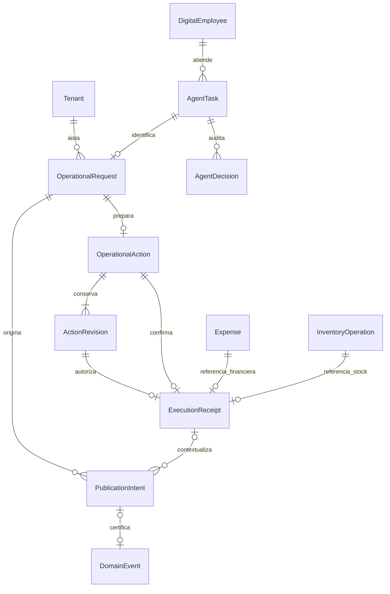

# Empleados digitales operativos — Etapa 4: modelo de persistencia

Fecha: 2026-10-14. **Estado: aprobado explícitamente** mediante «Aprobar Etapa 4 y pasar al esquema físico». Las Etapas [1](digital-employees-functional-definition.md), [2](digital-employees-use-cases.md) y [3](digital-employees-technical-design.md) también están aprobadas. Esta aprobación autoriza diseñar Etapa 5; no implementar ni ejecutar migraciones.

Este documento define registros lógicos, relaciones, ciclos e invariantes para F1–F3 y A1–A5. No modifica Prisma, tablas ni datos. Tipos físicos, índices, restricciones SQL, estrategia de bloqueo y migraciones corresponden a Etapa 5. Se aplica la [regla de aprobación secuencial](../PHASE_2_EXECUTION_RULE.md).

## 1. Encaje con el dominio y representación elegida

El [modelo de dominio](domain-model-v1.md), §9, conserva las entidades Empleado Digital, Tarea, Decisión, Escalación y Límite de Autonomía. `asistente_financiero` y `asistente_administrativo` son especializaciones existentes. No se crea un empleado del dominio por cada petición ni un contexto nuevo. Tenant sigue siendo la única unidad de aislamiento.

Los registros definidos aquí son soporte técnico de la atención del empleado: solicitud idempotente, propuesta revisable, contenido autorizado, evidencia de ejecución y publicación pendiente. No son nuevos conceptos financieros ni un reemplazo del historial de decisiones. Se alojan en el contexto de Agentes bajo los puertos aprobados en Etapa 3. Los nombres lógicos no obligan a crear una tabla por concepto, pero las invariantes y separaciones de autoridad son obligatorias.

Decisiones de representación:

1. Una solicitud tiene exactamente una tarea existente; una tarea de otros agentes no necesita solicitud operacional. Una solicitud de esta entrega admite como máximo una propuesta de comando.
2. La propuesta tiene revisiones inmutables. El estado mutable guarda solo su ciclo y la revisión vigente; no se sobrescribe silenciosamente el contenido que alguien aprobó.
3. El recibo inmutable identifica una ejecución confirmada. Una propuesta sin recibo no se presenta como negocio confirmado. Un error HTTP no es prueba de rollback.
4. El gasto y la operación de inventario conservan su dueño de dominio. El recibo guarda referencias y una proyección histórica mínima, no otra entidad Expense ni un balance alternativo.
5. Las intenciones de publicación se guardan con la auditoría o el efecto del negocio. Su estado de entrega es independiente del estado confirmado del negocio.
6. Los registros históricos de Recepcionista y Coordinador no se rellenan artificialmente para adaptarlos a este flujo.

## 2. Agregados y relaciones



El diagrama muestra relaciones lógicas, incluidas las referencias entre contextos; no autoriza lecturas que reconstruyan reglas ajenas. El agregado técnico de atención coordina solicitud, propuesta, revisiones y recibo. La intención de publicación tiene su propio ciclo de reclamación y entrega, vinculado a esa atención. `AgentTask`/`AgentDecision`, Expense, Inventario y Eventos mantienen sus propietarios actuales.

La cardinalidad Expense/InventoryOperation representa solo los resultados creados por este flujo: muchas operaciones humanas no tienen recibo de empleado. Cada recibo referencia exactamente uno de esos dos resultados. La misma operación de inventario o gasto no puede respaldar dos recibos del nuevo flujo.

## 3. Solicitud operacional — `OperationalRequest`

**Responsabilidad:** reconocer una petición reenviada, conservar su tarea y controlar quién puede terminar la interpretación o consulta.

| Atributo lógico | Significado |
| --- | --- |
| Identidad interna, Tenant y principal obligatorios | Alcance inmutable de toda recuperación; principal según el contrato de Etapa 3 |
| `requestId` | UUID aportado por el cliente; único dentro de Tenant/principal, incluso entre empleados |
| Empleado y tarea | Referencias únicas de la atención; se crean/vinculan en la misma transacción |
| Versión de contrato, modo y entrada canónica | Texto o intención/campos admitidos; nunca ambos como autoridades independientes |
| Huella de petición | Incluye versión, empleado, modo y contenido admitido; diferencia un reenvío de una reutilización incompatible |
| Estado técnico | `pendiente`, `procesando`, `resuelta` o `requiere_revision` |
| Generación, dueño y vencimiento de reclamación | Cercan la escritura de una respuesta tardía; no autorizan ningún comando |
| Resultado de atención | Consulta proyectada, aclaración, referencia de propuesta, rechazo o error recuperable identificado |
| Instantes y diagnóstico mínimo | Creación, última actualización, número de intentos y código de último error, sin secretos |

La reserva de request, el inicio de tarea y sus intenciones de auditoría son atómicos. La colisión por requestId con otra huella devuelve conflicto sin iniciar otra tarea. Una colisión idéntica devuelve la tarea existente y su estado; no repite una consulta ya resuelta automáticamente.

El reclamante obtiene una generación mayor y un plazo técnico de 30 segundos, superior al límite de 8 segundos del intérprete. La renovación o recuperación exige comparar generación/estado y comprobar el reloj del servidor. Un proceso caído no mantiene indefinidamente el derecho de escribir. El poseedor anterior no puede persistir resultados, propuestas ni decisiones después de perder la generación, aunque termine la llamada al proveedor. No se almacenan respuestas tardías como si fueran actuales.

Antes de guardar la salida del intérprete y antes de consultar o devolver datos, se vuelve a comprobar la autoridad vigente del operador sobre esa atención. Una interpretación terminada no es prueba de permiso. La creación de una propuesta exige además empleado habilitado; recuperar un resultado previo mantiene la excepción de lectura con empleado pausado aprobada en Etapa 3. La huella y la generación tampoco sustituyen esas comprobaciones.

Un reenvío autenticado puede recuperar la reclamación vencida para interpretación/lectura. No existe un worker que confirme comandos. Tras tres reclamaciones sin resultado, la solicitud pasa a `requiere_revision`, la atención se escala mediante el caso existente y conserva su diagnóstico; no se continúa en un bucle automático. El resultado de un rechazo normal del proveedor puede resolverse antes con el formulario, sin consumir tres intentos.

Una consulta o aclaración sin propuesta termina la atención con resultado explícito y tarea completada, sin efecto de negocio. Una nueva consulta corregida utiliza un requestId nuevo. Para una intención de escritura admitida con campos faltantes, se crea una propuesta `borrador`, que puede corregirse por el endpoint de acción existente. La solicitud queda `resuelta` al publicar esa propuesta, aunque su tarea continúe en proceso hasta terminar el ciclo de la acción. `resuelta` no significa gasto/stock confirmado.

Los resultados de consulta conservan instante de observación, parámetros, páginas/continuidad y condición de dato oficial o vista previa; no se recomputan silenciosamente al recuperar la misma solicitud. Actualizar la consulta requiere otra solicitud. La proyección se vuelve a filtrar con permisos vigentes antes de mostrarse; no se devuelve un snapshot que el operador ya no pueda consultar.

## 4. Propuesta y revisiones — `OperationalAction` / `ActionRevision`

### 4.1 Identidad y ciclo de la propuesta

| Atributo lógico | Significado |
| --- | --- |
| Identidad, solicitud/tarea, empleado, Tenant y principal | Inmutables y coherentes entre sí; el cliente no los reasigna |
| Tipo de comando | Solo `registrar_gasto` o `entrada_inventario`; no cambia al corregir campos |
| Estado | `borrador`, `lista`, `confirmada`, `descartada`, `vencida` o `rechazada` |
| Revisión vigente | Una sola referencia a una revisión de la misma acción |
| Clave interna de ejecución | Generada por servidor y estable; para inventario se asigna el UUID de InventoryOperation antes de ejecutar |
| Instantes de apertura/cierre | Reloj de servidor, con motivo terminal cuando corresponde |

Cada propuesta nace con una primera revisión, incluso si está incompleta. `borrador` significa datos faltantes, no permiso parcial. Solo una revisión completa/validada habilita `lista`. Corregir exige comparar la revisión esperada y que la acción siga abierta; se crea otra revisión y se actualiza la referencia vigente en el mismo commit.

### 4.2 Contenido inmutable de cada revisión

| Atributo lógico | Significado |
| --- | --- |
| Identidad de acción y número de revisión | Secuencia estrictamente creciente y única dentro de la acción |
| Versión del contrato/canonicalización | Permite comparar el mismo significado sin depender de cambios posteriores del serializador |
| Payload normalizado | Campos admitidos, defaults ya resueltos y selección inequívoca del recurso |
| Campos faltantes y validación | Determinan si esta revisión es borrador o está lista; no sustituyen validación al confirmar |
| Vista previa determinista | Exactamente los valores autorizables que ve el operador, con etiquetas históricas mínimas |
| Huella vinculada | Tenant, principal, empleado, acción, tipo, revisión, versión y contenido relevante |
| Evidencia de vigencia del producto | Identidad, estado, presentación, usos y política de lotes observados en A4; no se usa el saldo como autorización |
| Creada por y fecha | Principal autenticado y reloj de servidor; no una identidad producida por el LLM |
| Caducidad | Una revisión lista vence a los 15 minutos desde su creación |

Los campos de dinero se conservan sin representación binaria flotante: forma decimal canónica exacta con dos decimales, conforme a los contratos existentes. Las cantidades son enteras de unidades de presentación; no se guardan conversiones inferidas. Un gasto con fecha por defecto guarda la fecha ya resuelta antes de la vista previa. Ningún «hoy», «ahora» o nombre ambiguo se vuelve a interpretar para ejecutar.

La huella de una revisión no incorpora diagnósticos, textos decorativos ni marcas de publicación. Sí incluye todos los datos que alteran el efecto aprobado. El algoritmo físico y su codificación se fijan en Etapa 5, junto con ejemplos de equivalencia/rechazo. No se reutiliza la huella de solicitud como huella de comando.

### 4.3 Transiciones permitidas

| Estado inicial | Operación/condición | Estado final y efecto |
| --- | --- | --- |
| `borrador` / `lista` | Corrección de revisión vigente | `borrador` o `lista`, revisión nueva; ningún efecto de negocio |
| `lista` | Confirmación vigente, autoridad y dominio válidos | `confirmada` más recibo y efecto, en un solo commit |
| `borrador` / `lista` | Descarte explícito | `descartada`, sin efecto; cierre auditado de tarea |
| `lista` | Caducidad sin confirmación previa | `vencida`, sin efecto; cierre técnico auditado |
| `borrador` / `lista` | Rechazo definitivo de la atención | `rechazada`, sin efecto; motivo y cierre auditados |
| Cualquier terminal | Lectura o confirmación repetida | Sin transición; se devuelve el resultado visible o el rechazo correspondiente |

Un borrador incompleto puede descartarse; no se inventa una caducidad de confirmación para datos que nunca estuvieron listos. No se permite corregir una revisión lista ya vencida: se recupera su resultado y se prepara otra solicitud. La selección de la hora de validez ocurre después de obtener los bloqueos de autoridad/acción y antes del efecto, usando reloj actual de servidor, no el instante anterior a esperar el bloqueo.

Un cambio de metadatos de producto, revisión incorrecta, permiso revocado, error de serialización o infraestructura no convierte automáticamente la acción en rechazo terminal. Se devuelve el conflicto/rechazo sin efecto y, cuando siga siendo corregible y no haya vencido, se permite otra revisión. No hay estado durable `ejecutando` fuera de la transacción para gasto/entrada: o ese commit contiene el resultado completo o sigue sin confirmarse. El bloqueo/consumo condicional impide dos ganadores.

La propuesta confirmada y su revisión quedan inmutables. Descartar no anula un gasto ni una entrada; las correcciones de negocio futuras usan sus casos correspondientes y no borran el recibo original.

## 5. Recibo de ejecución — `ExecutionReceipt`

**Responsabilidad:** evidencia inmutable de que el efecto aprobado confirmó junto con su auditoría; es el punto de recuperación después de perder una respuesta.

| Atributo lógico | Significado |
| --- | --- |
| Identidad y Tenant/principal | Alcance inmutable de la ejecución, coincidente con la atención |
| Acción, revisión y huella ejecutada | Como máximo un recibo por acción y por revisión; revisión vigente que realmente confirmó |
| Clave/versión de ejecución | Conserva la identidad y el contrato del intento ganador |
| Tipo y referencia de resultado | Exactamente Expense o InventoryOperation; nunca ambos ni una referencia libre aportada por cliente |
| Tarea y decisión de ejecución | Auditoría existente que confirmó en el mismo UOW |
| Actor observado | Identidad y etiqueta mínimas del operador al confirmar; evidencia histórica, no permiso vigente |
| Fecha de confirmación | Instante del hecho, independiente de entrega posterior de eventos |
| Resultado histórico mínimo | Valores confirmados y referencias necesarias para mostrar qué ocurrió, con versión de proyección |

Para F3 el mismo commit incluye Expense, recibo, `confirmada`, decisión, cierre de tarea e intenciones. Para A5 incluye InventoryOperation/movimiento/saldo y esos registros, dentro de la transacción ya propietaria de Inventario. La barrera Expense/cierre de Etapa 3 permanece obligatoria para los tres comandos humanos afectados, aunque no creen recibos de empleado.

La entrada conserva además la unicidad actual de InventoryOperation por Tenant/principal/tipo/requestKey. El recibo referencia esa operación exacta; no copia su control de balances. Un gasto humano anterior no se deduplica por monto/descripción. El soporte idempotente de F3 es la identidad de esta acción y su recibo, no la igualdad accidental de datos financieros.

Después de comprobar identidad, Tenant activo, pertenencia y permisos actuales, recuperar un recibo precede a exigir empleado activo, propuesta vigente, producto activo o día abierto. La recuperación no crea otra decisión de ejecución ni otra intención de sus eventos. La anulación posterior de Expense no modifica el recibo: se muestra el hecho original y, cuando se consulte su estado actual por el contrato sancionado, se distingue de la situación actual.

Un recibo sin resultado de dominio o una InventoryOperation del flujo nuevo sin su recibo indican inconsistencia que requiere revisión. Se conserva el mismo identificador para reconciliar; no se genera otra entrada/gasto automáticamente. La interfaz no convierte una incoherencia en una autorización nueva.

## 6. Intención durable de publicación — `PublicationIntent`

### 6.1 Hecho pendiente de certificación

| Atributo lógico | Significado |
| --- | --- |
| Identidad estable y Tenant obligatorio | Identidad de certificación reservada antes del commit productor |
| Solicitud, tarea y causa local | Contexto de trazabilidad; recibo opcional en consultas/preparaciones |
| Identidad de emisión | Única por causa confirmada y posición del evento en esa causa; no deduplica todos los eventos del mismo nombre |
| Nombre/tipo, origen, payload, fecha del hecho | Sobre inmutable producido por el caso existente; se valida contrato y tamaño |
| Versión/huella del sobre | Comparación estricta ante replay de certificación |
| `domainEventId` | Ausente hasta certificar; luego relación única, mismo Tenant y contenido |
| Reclamación de certificación | Dueño, generación y vencimiento; solo cercan trabajo transaccional sin efectos externos |
| Diagnóstico de certificación | Contador, próximo intento, código de error y fecha; sin payloads en logs |

La causa identifica una transición confirmada de solicitud/acción/auditoría, no un contador de intentos de transacción. Un retry revertido no consume otra emisión histórica. Una revisión nueva sí puede producir otra decisión legítima; no se elimina por coincidir el nombre del evento.

Tenant y referencias provienen de la atención autenticada y se verifican contra sus registros. Si un evento de ciclo de Agentes no lleva Tenant en su payload actual, se usa el Tenant obligatorio del contexto transaccional como sobre; no se altera el significado del evento ni se depende de recorrer datos ajenos a ciegas. No se usa el certificador que ignora silenciosamente payloads sin Tenant. Los eventos internos de Eventos siguen excluidos de certificación recursiva.

### 6.2 Dos ciclos separados

| Ciclo | Estados y transición autorizada |
| --- | --- |
| Certificación | `pendiente` → `certificada`; un fallo recuperable conserva pendiente con diagnóstico/backoff; conflicto de identidad/contenido pasa a `requiere_revision` |
| Notificación | `no_iniciada` → `iniciada` → `verificada` o `requiere_revision`; solo se puede iniciar cuando hay certificación confirmada |

En una UOW corta, el worker certifica idempotentemente con notificación diferida y vincula el DomainEvent. Si hay replay, comprueba Tenant, tipo, origen, fecha y payload canónico. La reclamación de certificación puede recuperarse tras 60 segundos con generación nueva; solo el reclamante vigente puede confirmar el vínculo. El trabajo no llama al reactor ni hace HTTP.

El plan de reintentos de certificación es técnico y acotado por tanda: como máximo tres intentos de transacción, luego se conserva pendiente con espera creciente de 1, 5 y 15 minutos, con tope de 15 minutos entre tandas y diagnóstico visible. Un error permanente de contrato/configuración se deriva a revisión, sin bucle de llamadas ni descarte del hecho. La recuperación posterior mantiene la identidad original. No se promete progreso mientras el tipo de evento esté inválido o la infraestructura siga indisponible.

Antes de invocar el reactor se confirma en otra UOW la transición exclusiva `no_iniciada` → `iniciada`, con identificador de intento y fecha. Se deja la transacción y se notifica. **Ese derecho no se renueva ni se reclama por vencer un lease.** Una caída, timeout o ausencia de evidencia tras empezar produce `requiere_revision`; también si el proceso cayó antes de la llamada efectiva. No hay reenvío automático ni botón que vuelva a confirmar el negocio para recuperar una notificación.

Se conserva, como mínimo, el identificador/instante del inicio, el desenlace observado, código de fallo y referencias a EventDelivery/AutomationExecution disponibles. No se interpreta retorno normal del reactor como éxito global: `verificada` exige evidencia del contrato de los consumidores; ausencia de reglas aplicables se registra explícitamente como tal. Evidencia insuficiente o algún fallo deja `requiere_revision`, aunque otros consumidores sí hayan actuado. Estos campos se actualizan condicionalmente con el mismo identificador de intento, sin volver a llamar al reactor.

Todos los DomainEvent ligados a estas intenciones quedan fuera del retry genérico desde su certificación, antes de notificar por primera vez. La relación es durable y el filtro existe antes de habilitar el worker. Los consumidores legacy mantienen su mecanismo histórico; este documento no les atribuye durabilidad ni entrega exactamente una vez.

## 7. Tarea, decisión y resultado proyectado

Se conservan `AgentTask.status = en_proceso/completada/escalada` y los contratos existentes. La solicitud aporta el Tenant/principal inmutable sin una migración global del historial de todos los agentes.

| Situación | Tarea | Resultado de atención |
| --- | --- | --- |
| Interpretación en curso o propuesta abierta | `en_proceso` | Referencia del request/propuesta y situación actual |
| Consulta o aclaración sin propuesta | `completada` | Datos autorizados o aclaración requerida; efecto `ninguno` |
| Comando confirmado | `completada` | Referencia del recibo; efecto confirmado |
| Descarte, vencimiento o rechazo definitivo | `completada` | Motivo explícito; efecto `ninguno` |
| Solicitud sin recuperación automática segura | `escalada` | Escalación existente y diagnóstico, sin suponer un efecto |

`AgentDecision` conserva entrada estructurada mínima, acción y justificación verificable: datos faltantes, permiso comprobado, revisión aceptada o motivo de no actuar. No almacena razonamiento privado del modelo, cookies, tokens ni instrucciones completas innecesarias. El vínculo del recibo a la decisión de ejecución distingue ese hecho de las decisiones de preparación.

La situación de publicación se consulta en las intenciones; no reescribe el recibo inmutable ni convierte una tarea ya completada en otra ejecución. `AgentTask.result` mantiene referencias/versiones y una proyección mínima; no es la fuente de autoridad para reconstruir un payload confirmable ni una copia divergente del historial financiero.

Los GET son puros: pueden indicar vencimiento calculado, sin modificar registros ni emitir eventos. El worker de mantenimiento puede cerrar una propuesta lista vencida mediante transacción condicional y auditoría. Compite por la misma acción con confirmar/descarte; si estos ya ganaron, no emite un segundo cierre. No ejecuta negocio por tiempo.

## 8. Invariantes obligatorias

Estas reglas se concretarán en restricciones físicas y guardas transaccionales en Etapa 5; no basta una validación del navegador.

1. Todo registro nuevo tiene Tenant y principal cuando representa autoridad de operador; una intención siempre tiene Tenant y trazabilidad a la atención. Ninguna relación puede saltar de Tenant.
2. Solicitud, tarea, empleado, propuesta, revisión, recibo y resultado de dominio pertenecen a la misma atención/establecimiento. Una referencia válida por ID pero de otra atención no sirve.
3. La unicidad `(Tenant, principal, requestId)` conserva empleado y huella originales. No se reutiliza después de descartar o vencer.
4. Como máximo una acción por solicitud, una revisión vigente por acción, un número por revisión y un recibo por acción. La revisión confirmada pertenece a esa acción y coincide con la huella guardada.
5. `confirmada` implica recibo y resultado atómicos; recibo implica acción confirmada y decisión/tarea coherentes. Descarte/vencimiento/rechazo no tienen recibo ni efecto de ese comando.
6. La confirmación consume únicamente la revisión lista vigente, no vencida, con permisos actuales y controles de dominio. Solo un ganador puede crear efecto.
7. Un recibo tiene exactamente un destino válido: Expense para F3 o InventoryOperation de entrada para A5, con el mismo principal/clave en este último caso. Los destinos no se comparten entre recibos.
8. Las revisiones y recibos históricos no se editan; los errores o cambios posteriores se expresan por nuevos hechos y decisiones sancionadas.
9. Una generación vencida no termina solicitudes ni certificaciones. Ningún vencimiento de reclamación autoriza volver a notificar un efecto externo.
10. Las intenciones se guardan con la causa confirmada, una sola emisión por identidad de causa/posición. Un vínculo a DomainEvent se confirma con el certificado; no admite contenido distinto en replay.
11. Una notificación tiene como máximo un inicio durable; estados de revisión no borran ese inicio ni habilitan otro envío automático. La operación de negocio no depende de su éxito externo.
12. Autoridad, acción, barrera diaria y producto siguen el orden y UOW aprobados. No se ejecuta LLM/reactor/HTTP dentro de esas transacciones. Los caminos humanos recopilan por intento y publican legacy solo después del commit ganador.

## 9. Recuperación, consultas y datos conservados

| Punto de caída o repetición | Evidencia disponible y conducta |
| --- | --- |
| Antes del commit inicial de solicitud/tarea | No hay atención parcial; repetir mismo request puede crearla |
| Después de reservar, durante interpretación | Misma tarea; recuperación de generación solo para interpretación/lectura |
| Después de preparar, antes de responder | Recupera propuesta/revisión ya guardadas; no crea otra |
| Durante confirmación antes del commit | Todos sus cambios revierten; se comprueba recibo con lectura nueva antes de otro intento |
| Después del commit del comando, antes de responder | Recupera recibo original con permisos actuales; no reejecuta |
| Después del commit productor, antes de certificar | Intención pendiente; mismo identificador hasta certificar |
| Después de certificar, antes de vincular | Esa ventana no existe en estado confirmado: certificado y vínculo son el mismo commit |
| Después de marcar notificación iniciada | No se reenvía; evidencia o revisión humana, nunca otro gasto/entrada |

Los stores necesitan consultas acotadas por Tenant/principal: request por UUID; tarea/acción propia por ID; catálogo paginado de empleados; propuesta vigente y su recibo; solicitudes procesando con reclamación vencida; acciones listas vencidas; intenciones por estado y próximo intento; evidencia de notificación por ID. Los workers recorren lotes limitados y orden estable, no cargan toda la historia. Si una lista de pendientes se expone por HTTP, exige cursor y límite; no se introduce un endpoint sin ese contrato.

Se conservan los límites aprobados: entrada 4.000 caracteres, resultado proyectado 64 KiB, una intención funcional por solicitud, páginas 30/máximo 100 y financiero vivo por tramos de 31 días. Una atención puede producir varias intenciones de publicación de sus hechos y decisiones. El sobre de evento conserva los contratos existentes; no se trunca silenciosamente para ajustarlo al límite de una respuesta de UI.

No se programa borrado automático de solicitudes, revisiones, recibos, decisiones o intenciones en esta entrega. El vencimiento de la propuesta revoca su uso, no elimina la evidencia ni permite reutilizar requestId. No se habilita borrado en cascada desde Tenant/empleado/tarea hacia estos hechos. Una política futura de archivo/anonimización necesita conservar deduplicación, referencias e invariantes; no se elige un plazo legal o contable sin requisito del negocio.

El texto de entrada puede contener información personal: se limita al objeto de la atención y acceso autorizado, sin copiar conversaciones de WhatsApp. En logs solo IDs/códigos mínimos. Las proyecciones guardadas nunca sustituyen la comprobación de capacidad vigente ni permiten a otro operador recuperar el recibo por conocer su ID.

## 10. Evolución y compatibilidad

El [schema actual](../../prisma/schema.prisma) tiene `DigitalEmployee.tenantId` nullable y tareas/decisiones sin Tenant propio. El camino nuevo exige Tenant no nulo y guarda su alcance técnico explícito; no convierte filas históricas ambiguas en datos confiables. La Etapa 5 deberá impedir vínculos incompatibles con esos modelos legacy sin exigir rellenar todo su historial ni añadir soporte operacional a otros agentes.

Expense sigue siendo nullable en Tenant para historia anterior; el nuevo flujo solo referencia gastos con Tenant concreto coincidente. InventoryOperation ya tiene Tenant, principal, clave y evidencia; se reutilizan. DomainEvent ya tiene Tenant obligatorio y contenido del hecho; se amplía únicamente el contrato de certificación estable/diferida aprobado, conservando el catálogo de eventos.

No se crea por defecto ninguna instancia para tenants existentes o nuevos, no se cambia `tenant-provisioning` y no se altera el estado activo/pausado de empleados actuales. El administrador usa el registro ya existente y selecciona la instancia autorizada. La unicidad de especialización por Tenant no se inventa en esta etapa.

Los registros nuevos requieren versión de contrato/canonicalización y proyección. Una actualización compatible puede leer versiones anteriores para recuperar; nunca reinterpreta una revisión confirmada con defaults nuevos. Versiones no soportadas conservan la evidencia y devuelven un error diagnosticable, sin ejecutar otro comando.

## 11. Pruebas de invariantes y puerta de Etapa 5

La siguiente etapa debe asignar cada invariante de §8 a su mecanismo concreto: clave/relación/restricción SQL, unicidad, actualización condicional o transacción con verificación. Debe incluir estrategia de despliegue compatible y pruebas de PostgreSQL desechable, sin depender de solo mocks.

Casos necesarios de persistencia: conflicto requestId/huella, dos reclamantes y respuesta tardía; doble confirmación y PATCH frente a confirmar; vencimiento bajo espera de bloqueo; rechazo de relaciones cruzadas; rollback de gasto/stock ante fallo de recibo/auditoría; cierre humano concurrente; recuperación tras pausa o permiso revocado; certificación con replay distinto; crash en el inicio de notificación sin reenvío; conservación de unicidad después de expirar. Son obligaciones futuras de implementación, no pruebas ejecutadas de modelos que aún no existen.

No se dejan al esquema decisiones de producto nuevas: solo los ocho casos aprobados, autoridad por operador/Tenant, confirmación humana separada y dos comandos. No se implementa Recuperación de Clientes, campañas, agentes clínicos ni operación interna por WhatsApp. Las decisiones diferidas de Etapa 3 siguen vigentes.

La aprobación de este documento autoriza diseñar el esquema físico. **No autoriza aún modificar schema, ejecutar migraciones ni implementar endpoints/workers.** Es necesaria la aprobación explícita de Etapa 5 antes de programar.

## 12. Fuentes y validación de esta etapa

Fuentes: [arquitectura aprobada](digital-employees-technical-design.md), [dominio](domain-model-v1.md), [Agentes](../../backend/src/contexts/agents/index.js), [Finanzas](../../backend/src/contexts/finance/index.js), [Inventario](../../backend/src/contexts/inventory/application/use-cases/inventory.commands.js), [Eventos](../../backend/src/contexts/events/application/use-cases/register-domain-event.usecase.js), [schema vigente](../../prisma/schema.prisma) y [precedente de modelo de Inventario](inventory-persistence-model.md).

Revisión del `phase-2-reviewer`: sin hallazgos accionables tras contrastar dominio, arquitectura y schema reales. Comprobó generaciones/reclamaciones, separación de confirmación, revisiones/recibos, estado de tarea, aislamiento y publicación. Esta revisión no sustituye la aprobación funcional del responsable.

Comandos ejecutados el 2026-10-14 y extractos reales de salida:

```text
node scripts/check-docs.cjs — exit 0
"documents": 311,
"markdownFiles": 296,
"checkedLinks": 894,
"broken": [],
"missingDocReferences": [],
"nonPortableLocalLinks": [],
"catalogueErrors": [],
"exactDuplicates": []

node --test scripts/check-docs.test.cjs — exit 0
ℹ tests 6
ℹ pass 6
ℹ fail 0

npm --prefix frontend run lint — exit 0
> frontend@0.1.0 lint
> eslint
```

El comprobador emitió una advertencia de permisos al consultar el ignore global de Git y terminó con código 0. Esta etapa solo cambia documentos; no demuestra una implementación ni certifica la suite completa del backend. La ejecución completa previa del backend seguía sin diagnóstico tras terminar con código 1, como quedó registrado en Etapa 3; no se presenta como aprobada.
