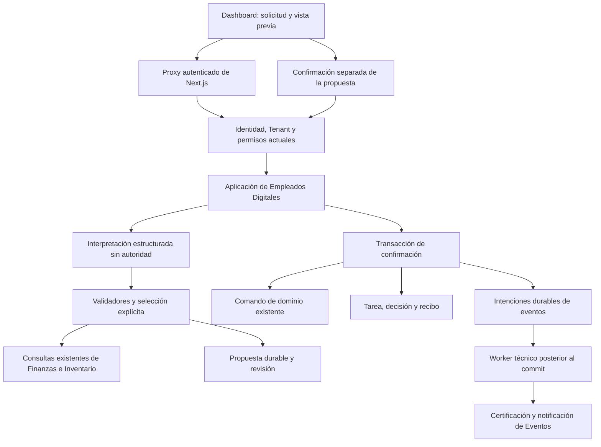

# Empleados digitales operativos — Etapa 3: Arquitectura técnica

Fecha: 2026-10-14. Estado: aprobado explícitamente por el responsable mediante «Aprobar Etapa 3 y pasar a persistencia». [Etapa 1](digital-employees-functional-definition.md) y [Etapa 2](digital-employees-use-cases.md) también aprobadas. La aprobación autoriza preparar el modelo de persistencia, no implementar código ni migraciones antes de las etapas restantes.

## 1. Alcance y decisiones principales

La primera entrega atiende F1–F3 y A1–A5 mediante dos especializaciones existentes de Empleados Digitales: `asistente_financiero` y `asistente_administrativo`. Recuperación queda fuera de esta implementación, como se aprobó en Etapa 2.

Se elige un módulo de aplicación dentro de Empleados Digitales, con adaptadores a Finanzas e Inventario. No se crea otro bounded context, un motor general de agentes ni una copia de los casos de uso. El dashboard es el canal inicial. El modelo interpreta solicitudes; el servidor decide permisos, valida propuestas y ejecuta únicamente los dos comandos aprobados tras confirmación humana.

Las decisiones que resuelven las brechas de Etapa 2 son:

1. Propuestas durables vinculadas a Tenant, operador, empleado, revisión y contenido exacto; la confirmación es una petición separada que el modelo no puede invocar.
2. Gasto, evidencia de ejecución, decisión y resultado de tarea se guardan en una sola transacción. Una confirmación repetida recupera el recibo, sin registrar otro gasto.
3. Entrada de inventario conserva `InventoryOperation` y su recuperación existentes; se agrega una integración transaccional acotada para incorporar confirmación y auditoría a la misma transacción.
4. La exclusión gasto/cierre utiliza una barrera común por Tenant y día civil, también en los invocadores humanos existentes. No basta envolver solo el camino del agente.
5. Los eventos del camino nuevo se recopilan como intenciones durables durante la transacción; un worker técnico los certifica y notifica después del commit. No se ejecuta el reactor de automatizaciones dentro de una transacción que todavía puede revertirse.

Estas son ampliaciones técnicas necesarias para las garantías aprobadas, no cambios de las reglas de negocio de precios, dinero, stock o permisos. El esquema y la representación física de la evidencia se presentan en Etapas 4 y 5.

## 2. Situación actual comprobada y reconciliación técnica

| Componente actual | Límite comprobado | Cambio necesario en el camino nuevo |
| --- | --- | --- |
| `registerExpense` | Consulta cierre, crea gasto y publica por separado; no recibe contexto transaccional ni clave de operación. | Propagar `ctx` opcional y conservar sus validaciones; añadir confirmación/recibo en la aplicación del empleado. |
| Repositorios de gasto y auditoría de agentes | Varias escrituras usan Prisma global. | Métodos compatibles con `ctx.tx ?? prisma`; caso de uso y puertos propagan el contexto. |
| `generateDailyClose` | No comparte UOW ni barrera con registrar/anular gastos. | Barrera común y contexto transaccional para el corte de Expense y el cierre. |
| `inventory.commands.entry` | Ya tiene transacción Serializable, bloqueo e idempotencia; no comprueba `expectedVersion` de metadatos como la edición del catálogo. | Punto de extensión interno bajo el bloqueo del producto para validar propuesta y guardar auditoría/recibo. |
| Publicadores certificadores actuales | Certifican inmediatamente, algunos omiten `ctx` y suprimen fallos; el reactor puede ejecutar acciones inline. | Recopilador transaccional estricto: intenciones durables en el flujo nuevo y publicación legacy posterior al commit en los comandos humanos que incorporan UOW. |
| `registerDomainEvent` | Acepta `ctx`, pero no identidad estable de certificación ni modo de notificación diferida. | Extensión interna aditiva para certificar idempotentemente sin reactor y notificar un evento ya certificado. |
| Retry de entregas | Descubre últimas entregas fallidas; no recupera una publicación que nunca llegó a certificarse. | Worker acotado a las intenciones nuevas; no atribuir esa recuperación al job existente. |

La reconciliación autoriza proponer soporte transaccional y de recuperación en esos puntos, sin reescribir el motor conversacional. Se mantienen los contratos predeterminados de otros consumidores. Debe existir evidencia de regresión antes de implementar/publicar, no solo el diagrama de este documento.

## 3. Dependencias y flujo



La aplicación no llama a rutas HTTP de su propio backend para ejecutar el dominio. Recibe puertos a los casos existentes. El dominio no recibe objetos Express, cookies, prompts o herramientas MCP.

## 4. Organización propuesta

Los siguientes son destinos de implementación futuros, no archivos ya creados:

| Ubicación | Responsabilidad |
| --- | --- |
| `backend/src/contexts/agents/application/operational/` | Solicitud, preparación, corrección, confirmación, descarte y recuperación de los ocho casos. |
| `backend/src/contexts/agents/application/ports/` | Acceso actual, almacenamiento técnico de propuestas/recibos, intérprete, reloj, UOW e intenciones. |
| `backend/src/contexts/agents/infrastructure/operational/` | Adaptadores Prisma, OpenAI y proyección segura de resultados. |
| `backend/src/routes/dashboard/operational-assistants.routes.js` | Adaptación HTTP, validación de forma y códigos de respuesta. |
| `backend/src/contexts/index.js` | Integración entre Finanzas, Inventario, Agentes y Eventos; evita imports circulares entre sus roots. |
| `backend/src/jobs/operational-assistant-events.job.js` | Reclamación de intenciones y su certificación/notificación posterior al commit. |
| `frontend/app/dashboard/assistants/` y componentes relacionados | Selección de empleado, entrada asistida, formularios, vista previa y resultados recuperables. |

El root de Agentes expone sus factories sin conocer los adaptadores de Finanzas/Inventario. El root de integración inyecta sus contratos y el publicador técnico del nuevo flujo. Se conservan las instancias y publicadores actuales de Recepcionista y Coordinador.

## 5. Identidad, autorización y selección del empleado

Se reutilizan `auth()`, el proxy server-side, `resolveTenant`, la matriz de capacidades y los lectores actuales. Desde componentes cliente se usa exclusivamente `proxyUrl`; no se envían secretos ni una identidad elegida por el modelo.

El nuevo flujo exige un Tenant concreto, existente y activo. Rechaza `viewAllTenants`, Tenant nulo, actor ausente o administrador sin correo autenticado. Un superadmin selecciona el establecimiento con el mecanismo sancionado del proxy; la aplicación recibe el Tenant ya resuelto y nunca interpreta una instrucción conversacional para cambiarlo.

La clave del principal mantiene el criterio actual: `staff:<staffId>` o correo administrativo normalizado. Los permisos se vuelven a leer desde la fuente vigente; no basta el snapshot de la propuesta. Las lecturas limitadas de Inventario conservan su proyección de campos y áreas. El historial de movimientos y ambos comandos exigen administración efectiva.

`allowVeterinaryDashboard` requiere una rama explícita para las rutas nuevas, antes de la denegación predeterminada de otros perfiles. Esa rama admite el acceso básico solo a quienes tengan Finanzas o `inventory_read`; cada acción y consulta aplica después su capacidad específica en la aplicación. No se reutiliza un permiso genérico de chat para abrir Finanzas.

El catálogo nuevo muestra solo instancias y capacidades permitidas. Se recibe un `digitalEmployeeId` seleccionado por el operador, y se valida Tenant, especialización y estado. Si hay varias instancias no se elige una arbitrariamente. El registro inicial sigue el caso administrativo existente `registerDigitalEmployee`; no se modifica por defecto el aprovisionamiento de nuevos tenants ni se ejecuta un backfill de producción desde esta pantalla. El administrador puede registrar las dos especializaciones y seleccionar su instancia.

Para un comando, las comprobaciones de Tenant, credencial/staff y empleado se realizan dentro del contexto transaccional. El adaptador debe estabilizar las filas cuya modificación revocaría la autoridad, mediante bloqueos de lectura compatibles con sus actualizaciones. La pausa o revocación que se completa antes de obtener esa autoridad impide el comando; una revocación concurrente espera la finalización de la operación que ya obtuvo el bloqueo. El orden de bloqueo se fija en §9 para evitar ciclos entre invocaciones nuevas.

## 6. Interpretación y respuestas

Se incorpora un adaptador de lenguaje separado de `openai.service.js`; no se reutiliza el analizador de reservas con otro prompt ni se modifica su historial. Su salida es un esquema cerrado de intención y campos admitidos para los ocho casos, nunca SQL, una ruta a invocar o código ejecutable.

El servidor valida tipos, campos adicionales, límites, fechas y campos faltantes incluso con salida estructurada del proveedor. Rechazos, respuesta incompleta, timeout o JSON inválido producen una solicitud de aclaración o el formulario equivalente; nunca autorizan una escritura. El modelo no recibe una herramienta de confirmación ni credenciales de infraestructura.

La entrada incluye únicamente el texto actual y el borrador autorizado de la misma tarea. No se mezclan mensajes del cliente de WhatsApp, conversaciones de otros operadores ni datos de otros tenants. Los reportes y nombres se tratan como datos, aunque contengan instrucciones.

Las cifras, alertas y resultados finales se renderizan desde DTOs validados mediante componentes y plantillas deterministas. El modelo no inventa explicaciones contables, calcula totales o decide la finalización de una operación. Una comparación sin fuente suficiente se presenta como no verificable.

La extracción se ejecuta fuera de transacciones con una fecha límite total de 8 segundos y sin reintentos automáticos en esta primera entrega; la confirmación no llama al modelo. La UI ofrece el mismo formulario validado si la interpretación no está disponible. Se conserva el proveedor/credencial de servidor existente; no se requiere otra API key para diseñar esta etapa ni se cambia el modelo del Recepcionista. El modelo específico del adaptador se verifica antes de implementar, sin elegir automáticamente uno nuevo.

Límites iniciales técnicos: texto de solicitud de hasta 4.000 caracteres, una intención atendida por petición y datos de resultado proyectados de hasta 64 KiB. Listados de Inventario conservan 30 elementos por defecto y 100 como máximo. Un historial financiero vivo se consulta por tramos de hasta 31 días civiles; un período oficial se recupera como hecho existente sin recalcularlo. Ante un resultado demasiado grande se pide acotar la consulta, no se trunca silenciosamente ni se presentan páginas como totales globales.

## 7. Propuestas, confirmación y contratos HTTP

La aplicación guarda la intención normalizada, revisión, huella canónica, autor, Tenant, empleado, reloj de creación y validez de cada propuesta. No utiliza localStorage como fuente de autoridad. Las propuestas listas para confirmar duran 15 minutos desde su última revisión; el límite reduce el uso de vistas previas olvidadas y no evita las comprobaciones de datos vigentes. Editar genera una revisión nueva y desautoriza la anterior. La representación persistente se define en Etapa 4.

La UI obtiene la vista previa exacta del servidor, muestra todos los defaults y realiza una petición separada por el botón de confirmación. No interpreta un «sí» dentro de texto, documentos o salida del modelo como esa petición. El endpoint de confirmar recibe identidad de propuesta y revisión, no el payload de negocio; el contenido se recupera del servidor.

Contratos propuestos bajo `/api/dashboard/operational-assistants`:

| Método y ruta relativa | Entrada relevante | Resultado |
| --- | --- | --- |
| `GET /` | Identidad autenticada, `limit` y cursor opcionales | Página de instancias y casos permitidos, con estados, capacidades mínimas y `nextCursor`. |
| `POST /:employeeId/requests` | `requestId` UUID, texto o intención/campos estructurados | Tarea, aclaración, consulta autorizada o propuesta; repetición del mismo request/contenido recupera esa atención. |
| `GET /tasks/:taskId` | Identidad y Tenant actuales | Estado y proyección autorizada de la atención propia. |
| `PATCH /actions/:actionId` | Revisión esperada y corrección de campos admitidos | Nueva revisión y vista previa; nunca ejecuta el negocio. |
| `POST /actions/:actionId/confirm` | Revisión esperada | Resultado comprobado o error/rechazo identificable; misma acción confirmada recupera su recibo. |
| `POST /actions/:actionId/discard` | Revisión esperada | Descarte de una propuesta pendiente; no anula hechos ya registrados. |
| `GET /actions/:actionId` | Identidad y Tenant actuales | Propuesta/recibo y situación de auditoría/eventos; no crea tareas ni efectos. |

El catálogo pagina después de filtrar visibilidad y especializaciones admitidas, con 30 instancias por defecto y un máximo de 100. Usa orden estable por ID y un cursor opaco validado, vinculado al Tenant/principal; el cliente no puede emplearlo para cambiar la identidad ni los filtros de autorización. Cada página relee permisos actuales. `nextCursor` es nulo al terminar; una página no se presenta como catálogo completo ni incluye un total no calculado. La pantalla conserva los cursores para continuar y permite seleccionar una instancia concreta aunque existan varias de la misma especialización.

Las rutas de seguimiento son de lectura y no reejecutan un comando. La recuperación de un resultado confirmado no exige que el empleado siga activo ni que el día siga abierto: exige permisos actuales y pertenencia a ese principal/Tenant. Un empleado pausado impide una ejecución nueva, no la lectura autorizada de un hecho previo. La suspensión del Tenant conserva el gate comercial vigente.

Una petición de interpretación/consulta se reclama con identidad y huella únicas antes de salir al proveedor. El trabajo de lenguaje se realiza fuera de la transacción y solo el poseedor de la reclamación vigente puede guardar su respuesta/propuesta. Si cae un proceso, se puede reclamar de nuevo con una marca de generación que invalida la respuesta tardía anterior; ese reintento solo interpreta o consulta, nunca confirma un comando. La referencia a la tarea y a la propuesta resultante es única para esa petición. La representación de reclamación y su caducidad pertenece al modelo técnico de Etapa 4.

El backend rechaza campos de identidad en cuerpos y campos no admitidos. El navegador no elige claves internas de ejecución, estado de tarea ni referencias de resultados. Se usa `Cache-Control: no-store`. Para mutaciones se verifica origen de la solicitud según la sesión y el origen configurado del dashboard; las llamadas de servidor conservan el contrato interno autenticado.

Códigos de adaptación: `400` forma/atributos; `401` falta de sesión; `403` falta de capacidad; `404` recurso no visible; `409` revisión/cambio/concurrencia; `410` propuesta vencida; `422` rechazo del contrato de dominio cuando corresponda; `503` fuente no disponible o resultado incierto. Se preservan los códigos del dominio existentes. La UI no elimina un pendiente ante timeout y no genera una acción nueva para resolver una respuesta perdida.

## 8. Contratos de aplicación y persistencia técnica

Los nombres siguientes describen puertos, no modelos Prisma aprobados:

| Puerto | Contrato |
| --- | --- |
| `OperationalAccessReader` | Releer identidad, Tenant activo, capacidades y principal; en escritura usa el mismo `ctx` y estabiliza autoridad. |
| `OperationalRequestStore` | Resolver de forma única una petición por Tenant/principal/requestId y huella; conservar su tarea, sin duplicar una atención por reenvío. |
| `AgentActionStore` | Guardar/corregir la intención, consumir condicionalmente revisión vigente y recuperar evidencia de ejecución vinculada al principal. |
| `FinanceReader` | Invocar las tres consultas ya expuestas con Tenant no nulo y adaptar fechas/DTO, sin copiar agregaciones. |
| `FinanceCommands` | Reutilizar `registerExpense` con `ctx` opcional y validaciones de canal preservadas en la aplicación sancionada. |
| `InventoryReader/Entry` | Reutilizar consultas y `entry/recover`; el callback de integración se ejecuta dentro del UOW y del bloqueo del producto. |
| `AgentAudit` | Reutilizar iniciar tarea, registrar decisión y completar/escalar con contexto opcional y publicador inyectado. |
| `PublicationIntentStore` | Persistir y reclamar intenciones de eventos con identidad estable y referencia a tarea/recibo. |
| `UnitOfWork/BusinessDayGate/Clock` | Contexto opaco único, exclusión por día y reloj sancionado. |

Propuesta, recibo, request e intención son soporte técnico de la tarea del empleado; no reemplazan Expense, InventoryOperation, DomainEvent ni constituyen otra unidad de aislamiento. Etapa 4 definirá qué registros/relaciones físicas satisfacen estos puertos, sin inventar una «Organización» o nuevo agregado financiero.

El catálogo de resultados de aplicación distingue datos faltantes, propuesta vigente, operación confirmada, descarte, vencimiento y resultado incierto. `AgentTask` conserva `en_proceso`, `completada` y `escalada`: una propuesta abierta mantiene la tarea en proceso; confirmación o descarte la cierran con un resultado explícito. `completada` significa atención terminada, no necesariamente escritura exitosa: el resultado señala si hubo efecto, rechazo o descarte. No se agregan pasos al motor WhatsApp.

Un worker técnico puede cerrar propuestas vencidas y sus tareas sin ejecutar negocio, mediante transacciones auditadas y los eventos existentes. Es mantenimiento del flujo durable, no una automatización comercial ni autorización para ejecutar propuestas por tiempo. Un `GET` calcula la indicación de vencimiento sin escribir ni publicar eventos.

## 9. Gasto, cierre del día y atomicidad

### 9.1 Camino de F3

La transacción verifica autoridad, bloquea/consume la revisión de la propuesta, obtiene la barrera del día y llama al caso actual de gasto. Incluye creación del gasto, recibo, decisión y finalización de tarea, además de intenciones de eventos. Si falla cualquiera de esas escrituras, nada de ese intento confirma.

Después de comprobar identidad y permiso actuales, se busca primero el recibo de esa acción. Si ya existe, la confirmación repetida lo recupera sin exigir empleado activo, vigencia de la propuesta ni día abierto y sin crear otra auditoría de ejecución. Solo la rama sin recibo exige esas condiciones para un efecto nuevo. La consulta del recibo y el bloqueo/consumo de la acción se coordinan para que otra confirmación no pueda superar la verificación concurrentemente.

Se agrega `ctx` opcional a los casos de uso y métodos de repositorio necesarios. Cuando no existe un contexto externo, registrar/anular gasto y generar cierre crean su propio UOW; cuando ya existe, se unen a él. No se capturan validaciones del dominio para ejecutar una escritura alternativa.

Los tres comandos humanos que incorporan UOW también recopilan sus eventos durante cada intento, sin invocar allí al publicador legacy. Solo después de que el UOW propietario retorna con commit confirmado se entregan los eventos del intento ganador al publicador actual, conservando contenido y política histórica de publicación. Cada retry crea otro recopilador y descarta el anterior; una reversión no publica. Esta cola local posterior al commit conserva el límite histórico de esos consumidores: una caída entre commit y publicación puede perder la publicación; no se les atribuye la durabilidad del nuevo flujo.

En el camino del empleado, el propietario del UOW persiste las intenciones durables con el resultado y no realiza esa publicación directa. Un invocador con `ctx` externo debe proporcionar el recopilador transaccional y asumir explícitamente su tratamiento al commit; se rechaza combinar un contexto externo con un publicador inmediato. Ninguna factory puede dejar el certificador legacy activo dentro de estos nuevos UOW, tampoco en la auditoría del empleado.

La identidad de ejecución y la huella del contenido aprobado son estables y únicas por Tenant/principal/acción. Dos confirmaciones concurrentes se serializan por el registro de acción y la restricción única del recibo; la perdedora recupera después del commit o reintenta con un snapshot nuevo. No se considera resuelta la idempotencia por comprobar primero si existe un gasto de igual importe o descripción.

### 9.2 Barrera común Expense/cierre

Se elige una exclusión transaccional de PostgreSQL por `(tenantId, día civil)`, capaz de proteger también un día que todavía no tiene `DailyClose`. No se bloquea solo una fila de cierre existente ni se usa un mutex en memoria como garantía de integridad de la base de datos. La forma física del bloqueo se especifica en Etapa 5.

Participan todas las llamadas operativas de `registerExpense`, `voidExpense` y `generateDailyClose`, humanas y de agente. La fecha de Expense es inmutable; la anulación resuelve primero el gasto del mismo Tenant y vuelve a verificar el cierre tras adquirir la barrera. El cierre consulta Expense en su contexto transaccional. Los repositorios de lectura usados por el cierre propagan ese contexto para no escapar a Prisma global.

Se conserva la misma política: si gana el gasto/anulación, el cierre incorpora su resultado; si gana el cierre, registrar/anular aplica el rechazo de día cerrado ya existente. Las transacciones usan aislamiento Serializable y reintentos acotados con snapshot nuevo; una lectura previa a esperar el bloqueo no se reutiliza como prueba de que el día sigue abierto.

La búsqueda de escritores operativos de Expense encontró el repositorio de registrar/anular; los fixtures de `scripts/serve-inventory-ui-local.cjs` son datos desechables locales y se mantienen fuera del flujo productivo. Esta garantía es la exclusión Expense/cierre requerida por F3. No certifica serialización global de todas las ventas o comisiones existentes ni cambia la política de esos otros comandos. Ese límite se declara sin promover toda la deuda financiera a este entregable.

### 9.3 Orden, reintentos y límites

En el nuevo flujo el orden es: Tenant/autoridad vigente, empleado, petición/acción, barrera del día si aplica y recurso de dominio. Para Inventario se bloquea después el producto y se valida la política antes del movimiento. Dentro de una categoría se ordenan IDs de forma estable. Los adaptadores que modifican autoridad usan bloqueos incompatibles con el permiso estable de la transacción; las pruebas deben incluir revocación y pausa concurrentes.

Se realizan como máximo tres intentos transaccionales por conflicto de serialización o bloqueo mutuo recuperable. Los códigos se contrastan con el cliente Prisma 7 instalado y su adaptador, incluyendo `P2034` y equivalentes PostgreSQL `40001/40P01` donde ya se utilizan. No se aplica un retry genérico de errores de validación o de red. Se limita la espera y el tiempo por intento; si no se resuelve antes del presupuesto de la petición se devuelve operación ocupada/resultado incierto y se recupera usando su identidad estable. Un timeout del proxy no garantiza rollback del backend.

No hay llamadas OpenAI, HTTP, reactor, envíos ni esperas largas dentro de estos UOW. El mismo intento usa un recopilador nuevo; los eventos de un intento revertido se descartan. No se anidan `$transaction`: un `ctx` existente se propaga hasta los adaptadores.

## 10. Entrada de inventario y propuesta vigente

No se envuelve `inventory.commands.entry` con una segunda transacción externa. Se añade un contrato interno de integración opcional a su `run/entry` actual para el camino de agentes:

1. Dentro del intento Serializable, verificar autoridad y consumir condicionalmente la acción vigente.
2. Adquirir el bloqueo actual del producto y comparar metadatos relevantes de la propuesta con el producto bloqueado: identidad, presentación, usos autorizados, política de lote y estado activo. Un cambio relevante exige nueva revisión. El mero cambio de saldo no altera la cantidad de entrada aprobada.
3. Ejecutar el mismo `addEntry`, validadores, registro de `InventoryOperation` y movimiento existentes.
4. Antes del commit, vincular recibo y decisión, completar la tarea y persistir las intenciones de los eventos producidos por el comando y la auditoría.

El callback interno recibe el contexto, el resultado comprobado y el evento que construye el propio comando; no reconstruye reglas ni nombres de negocio desde la ruta. Se vuelve a ejecutar en cada retry transaccional. Las llamadas existentes sin esta integración mantienen su contrato y su publicación actuales. En el modo nuevo se suprime la publicación directa posterior para no publicar también el mismo evento por dos caminos.

La clave UUID de `InventoryOperation` se asigna en servidor a la acción y permanece fija. Nunca se reutiliza ese modelo para guardar gastos. El recibo de agente y el movimiento confirman juntos; por ello un fallo de auditoría anterior al commit revierte también el stock.

Un recibo de agente ya confirmado se devuelve antes de cualquier reevaluación del comando. Si se detecta una operación de inventario sin su evidencia esperada, se entra en recuperación/reconciliación del mismo identificador, no en una entrada con otra clave. La recuperación actual conserva sus filtros por Tenant, principal, tipo y permisos vigentes. El estado inactivo posterior del producto no cambia la historia de una entrada ya confirmada.

## 11. Eventos durables y separación del efecto externo

### 11.1 Recopilación y certificación

En el flujo nuevo, los casos de uso publican sus eventos existentes a un recopilador inyectado que conserva nombre, payload, origen y fecha. Las intenciones se guardan dentro del mismo commit que la tarea/recibo. También las consultas/preparaciones que generan auditoría guardan sus intenciones con la tarea, aunque no exista una escritura financiera o física.

Se requieren extensiones explícitas en Eventos:

- Identidad estable opcional al registrar un evento, con verificación en replay de Tenant, tipo, origen, fecha y contenido canónico; una colisión diferente es un error, no éxito idempotente.
- Modo interno `dispatch: deferred`, optativo, que certifica el evento en `ctx` sin ejecutar el reactor.
- `findById(id, ctx)` en el repositorio y una operación interna para notificar un evento certificado existente, reutilizando el wiring del reactor y sus exclusiones actuales.

El worker certifica con identidad estable y vincula `domainEventId` a la intención en una única UOW corta. Si cae antes del commit, ambas escrituras revierten. Si cae después, encuentra la misma referencia y no crea otro certificado. Se conservan los nombres como `GastoRegistrado`, `EntradaDeInventarioRegistrada` y los del ciclo del empleado. No se crea un tipo financiero para «preparar» ni un evento de éxito por un resultado incierto.

Las llamadas actuales sin opciones nuevas conservan su comportamiento. La certificación/no-op del contexto Eventos sigue fuera de la certificación recursiva de sus propios eventos. No se duplica el catálogo global ni se conecta un publicador de agentes que pueda disparar el reactor dentro de la transacción del negocio.

### 11.2 Notificación después del commit y ambigüedad

El worker usa el patrón `node-cron` y la base de datos ya presentes; no añade Redis, un servicio de colas o una dependencia de infraestructura externa. Reclama intenciones de forma exclusiva y procesa lotes acotados. Certificación y reintentos transaccionales sin efectos externos sí pueden reintentarse con la misma identidad.

Antes de notificar, persiste la marca durable de inicio y libera la transacción. Luego invoca el reactor sobre el evento ya certificado. No hace envíos dentro del UOW. La marca no se vuelve a reclamar para notificar por expirar un lease: si un proceso cae después de iniciarla, queda como entrega incierta, aunque hubiera caído justo antes de enviar.

Los `domainEventId` administrados por estas intenciones se excluyen del job genérico de retry **desde antes de su primera notificación**. El filtro se limita a eventos ligados a este mecanismo; no altera los eventos legacy. Evita que otro job repita un evento cuyo efecto pudo ocurrir pero no quedó registrado como éxito.

El retorno normal de `evaluateAndExecuteRules` no prueba que todas las acciones tuvieron éxito: hoy registra fallos internamente. El worker registra el intento y la evidencia de entregas/ejecuciones disponible; solo informa un resultado confirmado cuando esa evidencia lo permite. Ante fallo o ambigüedad no reenvía automáticamente y requiere revisión humana. El recibo distingue negocio confirmado de publicación pendiente o atención requerida.

No se promete entrega externa exactamente una vez ni entrega eventual automática en esos casos inciertos. La operación financiera/física permanece confirmada y recuperable; resolver una entrega dudosa nunca reejecuta el gasto o la entrada. Añadir recuperación idempotente de efectos externos requeriría su propio diseño, no otra ejecución del reactor a ciegas.

## 12. UI, errores y operación

La página de asistentes muestra tareas pendientes y resultados por principal/establecimiento. Permite formulario estructurado cuando no se usa lenguaje natural, selección explícita de coincidencias, vista previa del servidor y confirmación/descarte separados. Los términos técnicos de idempotencia, `ctx`, MCP o publicadores no aparecen como decisiones del usuario del producto.

Una recarga recupera el estado del servidor. Cambiar de Tenant o cerrar sesión limpia el estado visual y aborta lecturas del contexto anterior; no transforma una operación incierta en una operación nueva. Las respuestas tardías del contexto anterior se ignoran. La UI no reutiliza directamente el hook actual de Inventario si este permite generar otra clave o reenviar contenido distinto del almacenado en la acción del servidor.

La observabilidad usa identificadores de tarea/acción y códigos, con datos personales minimizados. Sentry es una herramienta de diagnóstico si está configurada; no es el almacén del estado ni un requisito para confirmar operaciones. Los MCP de Codex no se instalan dentro del producto.

El worker expone estado, pendientes antiguos y fallos de certificación/notificación mediante los mecanismos operativos existentes. No se publica una versión como completa si no arranca ese worker, si hay caminos de escritura que escapan de la transacción requerida o si el proxy no permite recuperar una petición agotada. La configuración del cron y límites se documentan en la implementación, con arranque y tests explícitos.

## 13. Pruebas y puertas de implementación

Antes de implementar se aprueban esta arquitectura, el modelo de persistencia y el esquema físico. La implementación deberá verificar como mínimo:

- Contratos de F1–F3/A1–A5, proyección por permiso y aislamiento por Tenant/principal/tarea.
- Doble confirmación, misma identidad con contenido diferente, revisión vencida/sustituida, descarte y recuperación después de pausar al empleado.
- Dos gastos concurrentes de la misma confirmación, caída antes/después del commit y concurrencia entre registrar/anular gasto y cerrar el día, también desde rutas humanas.
- Entrada concurrente, cambios de política del producto bajo bloqueo, fallos de auditoría e idempotencia/recuperación de InventoryOperation.
- Ausencia de reactor/HTTP/LLM dentro de transacciones, también en los tres comandos humanos; rollback y retries publican cero eventos descartados, y la publicación legacy ocurre solo después del commit ganador. Certificación estable tras crash y exclusión del retry genérico antes de notificar en el nuevo flujo durable.
- Crash tras marcar inicio de notificación: requiere revisión y no dispara otra notificación automática.
- Fallo del intérprete, respuesta incompleta/rechazada y texto malicioso que intenta confirmar o cambiar Tenant.
- Presupuesto del proxy, recuperación tras timeout y revocación/pausa concurrentes.

La evidencia debe incluir PostgreSQL real desechable para concurrencia/rollback; mocks de Jest no prueban estas garantías. Se ejecutan además lint, pruebas relevantes y regresión de los contratos existentes. Los criterios comprobables por grep se ejecutan contra el repositorio completo, especialmente escapes a Prisma global y publicaciones directas en el modo transaccional nuevo.

## 14. Fuentes y límites de esta etapa

Contratos inspeccionados: [Finanzas](../../backend/src/contexts/finance/index.js), [registrar gasto](../../backend/src/contexts/finance/application/use-cases/register-expense.usecase.js), [generar cierre](../../backend/src/contexts/finance/application/use-cases/generate-daily-close.usecase.js), [UOW](../../backend/src/contexts/shared/persistence/prisma-unit-of-work.js), [Inventario](../../backend/src/contexts/inventory/application/use-cases/inventory.commands.js), [Agentes](../../backend/src/contexts/agents/index.js), [Eventos](../../backend/src/contexts/events/application/use-cases/register-domain-event.usecase.js), [publicador certificador](../../backend/src/contexts/shared/events/certifying-domain-event-publisher.js), [matriz HTTP](../../backend/src/middleware/allowVeterinaryDashboard.js) y [lector de acceso de Inventario](../../backend/src/contexts/inventory/infrastructure/prisma-access.reader.js).

Documentación técnica consultada: [transacciones de Prisma ORM 7](https://www.prisma.io/docs/orm/v7/prisma-client/queries/transactions) para conservar la versión instalada y los retries por conflictos; [salidas estructuradas de OpenAI](https://developers.openai.com/api/docs/guides/structured-outputs) para el adaptador de extracción, incluida la necesidad de tratar rechazos y respuestas incompletas. No se migra a Prisma 8 ni se cambia el motor de WhatsApp como parte de esta arquitectura.

Esta etapa propone puertos, flujos y garantías. No crea tablas, índices ni migraciones; no prueba que los nuevos callbacks, workers o endpoints existan. Los detalles lógicos de evidencias y relaciones se presentan en Etapa 4; SQL, índices y restricciones en Etapa 5.

### Evidencia de revisión y validación documental

El revisor de Fase 2 contrastó el diseño con los contratos del repositorio. Detectó y se corrigieron dos hallazgos: publicación legacy antes del commit en los comandos humanos que incorporan UOW, y falta de paginación en el catálogo de empleados. La segunda revisión confirmó ambas correcciones sin hallazgos adicionales en ellas. Es revisión de arquitectura, no aprobación funcional ni validación de código implementado.

Comandos ejecutados el 2026-10-14 y extractos reales de salida:

```text
node scripts/check-docs.cjs — exit 0
"documents": 310,
"markdownFiles": 295,
"checkedLinks": 880,
"broken": [],
"missingDocReferences": [],
"nonPortableLocalLinks": [],
"catalogueErrors": [],
"exactDuplicates": []

node --test scripts/check-docs.test.cjs — exit 0
ℹ tests 6
ℹ pass 6
ℹ fail 0

npm --prefix frontend run lint — exit 0
> frontend@0.1.0 lint
> eslint

git diff --check — exit 0, sin salida
```

El comprobador documental emitió además una advertencia de permisos al consultar el ignore global de Git; terminó con código 0 y los resultados indicados. Una ejecución anterior de la suite completa del backend terminó con código 1 sin resumen capturado: no se declara aprobada ni se atribuye una causa sin diagnóstico. No hay cambios de implementación en esta etapa; las pruebas de concurrencia, rollback, integración y regresión exigidas en §13 siguen pendientes de la implementación autorizada tras las cinco etapas.

## 15. Decisiones Arquitectónicas Diferidas

Estas decisiones no son tareas olvidadas ni autorización para resolverlas al escribir código. Conforme a la regla del proyecto, se resuelven mediante su propio ADR antes de ampliar el alcance:

1. **Más comandos y Recuperación de Clientes.** Casos de uso y arquitectura propios antes de añadir cierres, ventas, consumos, ajustes, devoluciones o campañas al catálogo de estos empleados.
2. **Operación interna por WhatsApp u otros canales.** No se reutiliza la identidad del cliente como identidad del operador.
3. **Autonomía de escrituras sin confirmación particular.** No se habilita por ausencia de configuración ni por una instrucción general de automatizar el negocio.
4. **Garantía de entrega eventual o exactamente una vez para efectos externos inciertos.** El tratamiento elegido es conservación de evidencia y revisión humana sin reenvío automático. Resolver idempotencia en el proveedor/consumidor exige diseño adicional.
5. **Serialización financiera global.** Esta entrega protege Expense frente al cierre; no rediseña todas las carreras previas de ventas/comisiones ni modifica la política de esos comandos.
6. **Motor general, memoria conversacional amplia o plataforma MCP del producto.** No se incorporan a estos ocho casos. Los agentes trabajan con la petición y borrador autorizados de su tarea.
7. **Modelo LLM distinto y optimización de costos.** Se verifica un modelo compatible del proveedor ya utilizado antes de implementar; cambiarlo o migrar APIs exige una decisión explícita sin alterar el Recepcionista. La ejecución de los comandos nunca depende de que el modelo confirme una acción.

No quedan diferidas la confirmación vinculada, la atomicidad, la recuperación ni la idempotencia de gasto: forman parte de las decisiones obligatorias de esta arquitectura y deben concretarse en las siguientes etapas aprobadas antes de implementar.
