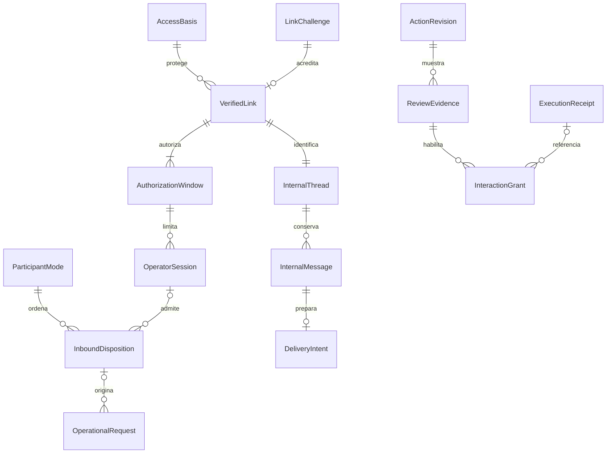

# Empleados operativos por WhatsApp — Etapa 4: modelo de persistencia

Fecha: **2026-10-15**, Colombia. **Estado: Etapa 4 aprobada explícitamente por el responsable.**

Aprobación recibida: «Aprobar Etapa 4 y pasar al esquema físico». Autoriza preparar la [Etapa 5](operational-employees-whatsapp-physical-schema.md); no autoriza implementar ni ejecutar migraciones.

El responsable aprobó «Aprobar Etapa 3 y pasar a persistencia». Base: [Etapa 1](operational-employees-whatsapp-functional-definition.md), [Etapa 2](operational-employees-whatsapp-use-cases.md), [arquitectura aprobada](operational-employees-whatsapp-technical-design.md), [ADR 022 aceptado](../decisions/022-empleados-operativos-canal-whatsapp.md) y [modelo de dominio](domain-model-v1.md). Se aplica la [regla de aprobación secuencial](../PHASE_2_EXECUTION_RULE.md).

Se definen registros lógicos, agregados, propiedad, ciclos e invariantes. Los nombres no obligan a crear una tabla por concepto. Tipos Prisma/SQL, claves físicas, índices, triggers concretos y migraciones corresponden a Etapa 5. **No se modifica Prisma, código, credenciales ni datos.**

## 1. Propiedad y reutilización

| Propietario | Información que conserva |
| --- | --- |
| Fuentes de identidad actuales | Staff/credencial, cuenta administrativa real, permisos y módulos. Son la autoridad; una copia de un rol en un mensaje no lo es. |
| Aplicación de acceso a canales | Evidencia de verificación, generaciones de acceso, vínculo revocable, autorización temporal, sesión y modo. Son soporte de acceso, sin nuevo contexto de negocio. |
| Comunicación | Hilo/mensaje interno, destinatario verificado, interacción ofrecida y resultado de entrega. No se almacena en `Conversation/Message` de clientes. |
| Empleados Digitales | `OperationalRequest`, `OperationalAction`, `ActionRevision`, `ExecutionReceipt`, `PublicationIntent`, tareas y decisiones existentes. No se duplican. |
| Finanzas / Inventario | Gasto, entrada, movimientos y saldos reales; conservan sus reglas, transacciones y recibos de dominio. |

Todo registro operativo exige Tenant. Los que contienen trabajo privado exigen además el principal canónico real. El metadato global del emisor administrativo solo controla autenticación: no agrupa negocios ni permite consultar sus datos. Para utilizarlo siempre se necesita un vínculo y un alcance operativo de un Tenant concreto.



El diagrama representa relaciones lógicas, no un esquema físico. La misma solicitud/acción puede leerse desde dashboard y WhatsApp bajo su dueño original; el recibo sigue siendo único. Un callback repetido puede recuperar un recibo producido desde el otro canal, sin generar otra operación ni otro evento.

## 2. Autoridad, generaciones y ruta

### 2.1 Registro del emisor administrativo

Conserva identidad estable del emisor, instancia activa, época monotónica, principal administrativo actual, generación HMAC de credencial, versión de clave/contrato, estado y fechas de registro. No contiene contraseña, secreto HMAC ni un hash de contraseña trasladado desde Next.js.

- Una instancia solo sirve pruebas mientras su época sea la activa. Repetir su registro con el mismo identificador de operación devuelve el resultado anterior; no crea otra época ni reactiva un emisor reemplazado.
- Un nuevo arranque autorizado obtiene otra época. Si mantiene generación de credencial, los vínculos permanecen utilizables tras comprobar la nueva autoridad; cambiar generación invalida los anteriores.
- La sustitución de emisor/generación y su auditoría son atómicas frente a las comprobaciones de efectos. Se conserva la evidencia histórica, sin sobrescribir el origen de pruebas pasadas.
- Disponibilidad del emisor se comprueba en vivo; tener un registro no es una respuesta positiva almacenada para usar cuando Next.js está caído.

### 2.2 Base de acceso por establecimiento y principal

Conserva referencias a la fuente de identidad, principal canónico, Tenant, generación de credencial/identidad y generación de permisos, además de la generación de habilitación/módulos del Tenant. No almacena un rol alternativo que sustituya al lector vigente.

| Cambio en la fuente | Efecto lógico persistido |
| --- | --- |
| Desactivar/eliminar Staff o credencial, cambiar contraseña/versión de sesión, correo autenticable o Tenant del Staff | Avanza la generación de identidad; vínculos de la generación anterior quedan revocados lógicamente y requieren nueva vinculación. |
| Cambio administrativo de correo/credencial/clave en el emisor | Avanza su generación, invalida vínculos anteriores y bloquea respuestas/interacciones basadas en ella. |
| Cambiar rol, permisos o módulos habilitados | Avanza la generación de acceso; invalida revisiones de acceso, interacciones y respuestas afectadas. El permiso actual se vuelve a consultar. |
| Suspender/reactivar Tenant | No permite operar mientras esté suspendido; avanza su generación para que restaurarlo no reviva propuestas o entregas anteriores. |
| Nombre o dato de contacto sin autoridad | No concede permiso ni mueve el vínculo a otro teléfono. Las etiquetas históricas permanecen como evidencia. |

Las generaciones solo avanzan. Desactivar y reactivar entre mensajes no recupera el valor anterior. El cambio y su invalidación son parte del commit de la fuente mediante los triggers de infraestructura aprobados en arquitectura; no dependen de una automatización posterior. Los registros de referencia conservan tombstones ante eliminación: que desaparezca la fuente deniega acceso, no elimina recibos ni permite reutilizar su identidad.

Una propuesta cuya base de permisos cambió debe revisarse otra vez con datos y autoridad actuales; no se confirma usando la generación previa. La autoridad de un vínculo y la validez de una vista son controles distintos: perder un permiso no otorga otro, y recuperar una capacidad no reactiva sus botones anteriores.

### 2.3 Ruta del canal

Conserva Tenant, proveedor, dirección receptora real, referencia al `Channel`, versión monotónica de configuración y estado de habilitación. No almacena el token de Meta; este permanece en configuración protegida del proveedor.

La habilitación exige correspondencia inequívoca entre receptor firmado, Tenant activo y línea saliente configurada. El `Channel` global existente solo puede participar mediante esa correspondencia explícita, nunca como fallback. Cambiar línea/configuración avanza versión, cierra sesiones e invalida entregas/interacciones anteriores. Un registro de ruta no autoriza a usar otro Tenant.

La combinación de proveedor/dirección receptora activa no puede resolver ambiguamente dos Tenant. Una configuración inconsistente bloquea el modo interno. La ruta histórica permanece referenciable aunque deje de estar habilitada.

## 3. Verificación y vínculo

### 3.1 Desafío de vinculación

| Datos lógicos | Finalidad |
| --- | --- |
| Identidad, Tenant, principal y ruta esperada | Delimitar quién puede finalizar y dónde debe probarse el teléfono |
| Número esperado normalizado | Comprobar control del destinatario exacto; no es `Staff.phone` como autoridad |
| Digest HMAC/versiones y vencimiento | Comparar la prueba sin persistir un código reutilizable |
| Prueba reciente del dashboard y su consumo | Evidencia de identidad actual, ligada al propósito, número y desafío |
| Evento del teléfono verificado | `wamid`, receptor, remitente e instante, sin código original |
| Intentos/estado/versión de concurrencia | Límites y un solo ganador en prueba, reemplazo o activación |
| Referencia de reemplazo y auditoría | Mantener el vínculo anterior hasta completar el nuevo |

Estados lógicos: `pendiente_prueba` → `probado` → `consumido`. Antes de consumo puede terminar como `vencido`, `agotado`, `cancelado` o `sustituido`; esos terminales no vuelven a activo. El plazo total es cinco minutos desde creación, también para activar después de probar. Repetir el evento de prueba reconoce el mismo resultado y no extiende ese plazo.

Solo la identidad iniciadora puede activar, con comprobación reciente vigente y prueba del número correcto. Consumir desafío y prueba reciente, crear vínculo/ventana/hilo y sustituir el vínculo anterior son una sola operación indivisible. Un conflicto no consume la prueba ni revoca el vínculo anterior como si hubiese activado correctamente.

Un intento desde otro número no afecta los cinco intentos del número esperado ni revela su identidad. Se limita separadamente el abuso por remitente. Se registra de forma durable cada inicio admitido para comprobar un máximo de tres por cuenta/Tenant en una ventana móvil de una hora y separación mínima de 60 segundos; reiniciar el servicio no reinicia el cupo.

### 3.2 Vínculo verificado

Conserva identidad propia, Tenant/principal, número normalizado, ruta/canal, desafío que lo acreditó, generación de identidad observada, fechas, versión y causa/autor de cierre. El operador y el número del vínculo son inmutables; cambiarlos crea otro vínculo.

Estados: `activo`, `revocado` o `sustituido`. Solo existe un vínculo activo por operador/ruta y un único operador activo por número/ruta/Tenant. La exclusión se comprueba de forma atómica; no se deduce de una búsqueda previa. Activar un reemplazo cierra el anterior, invalida sus sesiones/interacciones/entregas y crea otro vínculo. No fusiona sus memorias con un cliente ni atribuye el número al operador anterior.

La revocación por cambio de generación puede derivarse sin actualizar todas las filas: `activo` persistido no basta si su generación ya no coincide. La aplicación informa el cierre efectivo y conserva el motivo de la fuente. Rehabilitar la cuenta no reactiva ese vínculo. Al revincular al mismo principal, la activación materializa el cierre del vínculo anterior inválido antes de crear el nuevo, dentro de la misma operación, para conservar la exclusión de activos. Un número asociado a otro principal no se toma automáticamente: exige resolver/revocar el conflicto desde dashboard con autoridad vigente.

### 3.3 Autorización temporal del vínculo

Cada activación o renovación autenticada crea una ventana de autorización inmutable: vínculo, prueba reciente consumida, generación de identidad, instante inicial y vencimiento absoluto ocho horas después. El vínculo selecciona una ventana actual mediante versión monotónica.

Renovar crea otra ventana e invalida las sesiones/interacciones anteriores. No cambia el teléfono ni elimina las ventanas históricas. Un vínculo puede seguir verificado cuando su ventana terminó, pero no concede modo negocio hasta reafirmar identidad en dashboard. La actividad del chat nunca amplía las ocho horas.

Las credenciales administrativas/personales se comprueban contra su fuente; no se persisten en esta ventana. Una sesión vieja de navegador o una ventana anterior no sirve como prueba reciente.

## 4. Sesión, modo y orden de entrada

### 4.1 Sesión interna

Conserva Tenant/principal/vínculo, ventana actual, ruta y generaciones observadas, hilo interno, instante de apertura, última actividad autorizada, vencimiento por inactividad, versión y cierre. Hay como máximo una sesión activa por flujo de remitente/receptor.

La autorización efectiva exige simultáneamente cuenta y vínculo vigentes, ventana actual dentro de ocho horas, ruta/versiones actuales, permisos y menos de quince minutos de inactividad. El reloj es del servidor al comprobar el efecto. Expirar es una condición comprobable aunque ningún job haya actualizado aún una etiqueta de estado.

Abrir después de inactividad crea otra sesión dentro de la ventana existente; no reabre la anterior ni recupera sus botones. La apertura posterior a ocho horas exige nueva ventana del dashboard. Mensajes rechazados, duplicados, consultas de cliente o entregas del sistema no renuevan inactividad; solo una nueva entrada interna autorizada. Una redelivery no prolonga una sesión por segunda vez.

### 4.2 Estado de modo por participante

La clave lógica comprende Tenant, proveedor, receptor real y remitente normalizado; no requiere cliente ni vínculo previo. Conserva modo `cliente`, `negocio` o `bloqueado`, versión monotónica, referencia a sesión/vínculo cuando proceda y causa de bloqueo. Esto permite que un flujo interno revocado permanezca bloqueado sin caer al bot de reservas.

`/negocio` abre acceso solo tras autorización. `/clientes` cambia explícitamente a cliente, cierra sesión e invalida interacciones internas; no borra tarea o recibo. Expiración, revocación o cambio de ruta bloquean el modo interno. Un botón viejo o comando inválido no se interpreta como texto para el Recepcionista. Cambiar modo no modifica `Conversation.status`, asignación humana ni wizard del cliente.

Se conserva además una secuencia de admisión por flujo para ordenar mensajes recibidos por el servidor y cambios de modo. No se confía en el orden léxico de `wamid` ni en el timestamp elegido por el remitente. El worker no adelanta un mensaje posterior de ese flujo a su cambio de modo pendiente; los reintentos mantienen el mismo ordinal. Mensajes previos a una apertura no se reinterpretan como si hubieran pertenecido a la sesión nueva.

## 5. Hilo y mensajes internos

Un vínculo activado tiene un hilo interno propio de Tenant/principal/ruta. Una sesión pertenece a ese hilo; otra sesión del mismo vínculo puede continuar una tarea propia mediante revalidación. Sustituir vínculo no copia automáticamente mensajes al nuevo teléfono. Un recibo propio sí se recupera por la aplicación bajo la identidad y permiso actuales, sin importar dónde se inició.

Cada mensaje interno conserva hilo, Tenant/principal, dirección, actor real o empleado/sistema, contenido admitido, instante, evento/delivery de origen, sesión y clasificación de acceso necesaria. El contenido y su atribución son inmutables; el estado de entrega vive aparte. No se guarda un razonamiento privado del modelo ni un código de vinculación.

| Relación | Invariante |
| --- | --- |
| Mensaje entrante / evento | Como máximo un mensaje interno por evento aceptado; un duplicado no añade memoria |
| Mensaje saliente / intención | Una salida lógica tiene su intención recuperable; reintentar no crea otra tarea de negocio |
| Mensaje / tarea, propuesta o recibo | Referencias del mismo Tenant/principal; una referencia sola no autoriza lectura |
| Mensaje / clasificación | Finanzas, administración de inventario o lectura por área conservan sus restricciones, incluidos costos ocultos |
| Hilo / sesión | La sesión señala contexto permitido, nunca presta autoridad a todo el histórico |

Leer el historial requiere acceso actual a cada contenido. Una reducción de permisos no deja visibles mensajes financieros anteriores por ser «propios». Consultas con base de acceso caducada se vuelven a consultar si se solicitan; no se reenvía la respuesta antigua como dato actual. El recibo histórico autorizado mantiene su naturaleza de hecho confirmado.

No hay `userId` ficticio ni relación por igualdad de teléfono con `User`. Bandeja, RAG, búsquedas y memoria de clientes no incluyen estos registros. Un administrador que puede revocar vínculos ve metadatos de gestión, no conversaciones privadas ajenas. La auditoría compartida de tareas/escalaciones contiene referencias y códigos mínimos, sin copiar resultados financieros a una bandeja más amplia.

## 6. Entrada recuperable y correspondencia con el trabajo existente

### 6.1 Disposición de entrada

Conserva proveedor/ID estable, ruta/Tenant, remitente, secuencia de flujo, hash de entrada sanitizada, versión de sobre, modo/sesión admitidos, generación y dueño del procesamiento, resultado de enrutamiento y referencias a trabajo/respuesta. Distingue cliente, operador y control genérico sin intercambiar sus destinatarios.

La cola sigue siendo `InboundJob`; no se crea una segunda cola de consumo. La clave de deduplicación conserva su contrato global proveedor/ID de evento. Una colisión con otro Tenant no revela su atención ni permite reasignar el evento. El registro de disposición puede representarse como parte del sobre/checkpoint o soporte relacionado, según Etapa 5. Debe cumplir:

1. La sanitización de secretos ocurre en memoria después de validar firma y antes de todo almacenamiento durable. El sobre de vinculación contiene digest y metadatos, nunca el código. Un ID de interacción nativa se transforma en referencia/digest verificable antes de colas/logs generales.
2. Evento, ordinal y reserva de job se admiten sin una brecha que confirme recepción y pierda el trabajo. Un mismo evento conserva contenido/ruta y ordinal; una colisión incompatible se rechaza.
3. Antes de invocar un empleado se reserva el UUID de solicitud para ese paso. Reintentar usa el UUID existente, empleado, dueño y hash originales; no fabrica otra solicitud después de un crash.
4. El paso que solo corrige/selecciona/descarta referencia la acción y revisión existentes. La correspondencia admite subpasos identificados de forma estable; no habilita ejecutar varios comandos inferidos de un mensaje.
5. Una reclamación tiene generación y vencimiento. Solo el reclamante vigente termina el paso/checkpoint; un proceso tardío no escribe sobre una revisión o modo posterior.
6. Una vez admitido como operador, el evento no se reasigna a otro principal por sustituir el vínculo. El duplicado se recupera solo bajo autorización actual; si ya no procede, queda bloqueado.

Se reutilizan `OperationalRequest` y su fencing para interpretación/lectura, `OperationalAction` y su clave para la propuesta, y `ExecutionReceipt` para ejecución. No se mantiene un segundo estado financiero «confirmado» en el ledger de WhatsApp.

### 6.2 Origen y revisión entre canales

La solicitud/tarea conserva origen de confianza y referencias de correlación al canal, añadidos por servidor. El texto nunca contiene el principal que se usará como autoridad. Las revisiones existentes siguen guardando el comando canónico, la huella y la caducidad originales.

Se incorpora evidencia de revisión de acceso asociada a la revisión exacta: Tenant/principal, generaciones de permisos y Tenant, canal/sesión cuando proceda, hash mostrado y fecha. No modifica el payload de una revisión inmutable ni su recibo. Una misma revisión puede mostrarse en otra sesión mientras siga vigente y sus datos/base de acceso sean válidos; cada visualización que permita confirmar tiene evidencia propia.

La regla de la primera entrega de [persistencia operativa](digital-employees-persistence-model.md) rechazaba corregir una propuesta vencida y pedía otra solicitud. La arquitectura nueva aprobó una extensión acotada: **renovar una acción todavía abierta, sin recibo ni cierre terminal**, revalidar su contenido y crear otra revisión. Conserva acción y clave de ejecución; la revisión vencida no cambia de fecha ni vuelve a ser confirmable. Una acción ya cerrada como vencida/rechazada/descartada no se reabre. Si es necesario otro trabajo se inicia mediante decisión explícita, conservando evidencia del anterior.

Un cambio de base de permisos exige nueva revisión antes de confirmar, también si esa acción se abre desde el otro canal. Una simple nueva sesión exige nueva evidencia/acción de confirmación de la vista vigente, sin extender sus quince minutos. El contexto de WhatsApp no se exige para una confirmación legítima desde dashboard, que aplica su autenticación actual; sí se exige la base de permisos vigente y la revisión exacta.

## 7. Interacciones, confirmación y recibo

### 7.1 Evidencia de revisión e interacción ofrecida

Una interacción conserva propósito cerrado —confirmar, corregir, descartar, seleccionar o continuar lectura—, Tenant/principal, vínculo/ventana/sesión y modo, generaciones de acceso/ruta, referencia al mensaje saliente, objetivo exacto, revisión/hash o selección permitida, digest/versiones del ID, vencimiento, consumo y resultado.

La interacción de confirmar exige propuesta íntegra y lista, evidencia de revisión y vencimiento no posterior al de la propuesta/sesión/ventana. Los datos del comando no se aceptan desde el callback. Una selección conserva producto/consulta autorizados; el modelo no puede fabricar otra elección mediante un nombre o ID.

Estados lógicos: `preparada`, `ofrecida`, `consumida` o `invalidada`. Expiración es comprobable por reloj aunque aún figure ofrecida. Solo se ofrece al existir evidencia del mensaje de propuesta enviado y su correlación verificable. Una entrega incierta sin esa evidencia no habilita el botón. El ID se construye mediante clave de infraestructura y referencia/versiones; no se persiste como secreto reutilizable en el checkpoint.

Corregir, renovar, cambiar de modo/sesión, revocar acceso o perder coincidencia de generaciones invalida la interacción anterior. El registro histórico permanece. Texto libre, título de botón, mensaje reenviado o ausencia de contexto requerido no cambian su estado a consumido.

### 7.2 Consumo y transacción de negocio

| Situación | Resultado persistido |
| --- | --- |
| Confirmación nueva válida | Consumo de interacción, efecto de dominio, recibo único, auditoría y publicación pendiente se confirman en el mismo UOW. |
| Error previo al commit | Ninguno de esos efectos se presenta como confirmado; el consumo no queda como falsa prueba de ejecución. |
| Confirmación concurrente o repetida | Se recupera el mismo recibo bajo permisos actuales; no crea otro gasto/entrada ni otra emisión de su evento. |
| Dashboard confirmó primero | La interacción puede vincularse al recibo existente bajo autorización actual, sin ejecutar ni volver a certificar el negocio. |
| Vínculo/sesión ya inválidos | El callback no devuelve datos privados; recuperar el recibo exige W11 desde una sesión/canal autorizado. |
| Resultado sin evidencia coherente | Se conserva referencia y estado de revisión; no se genera otra clave para intentar de nuevo. |

Los hooks transaccionales de Inventario y el UOW de Finanzas conservan propiedad del efecto. El recibo continúa siendo inmutable y referencia exactamente un gasto o una operación de inventario. Varias interacciones pueden referir ese mismo recibo al recuperar; esa referencia no se declara única ni representa varias ejecuciones. Revocar después no anula esos hechos ni elimina auditoría. El consumo de una selección/corrección sin escritura de negocio se confirma junto con el cambio de atención correspondiente.

## 8. Intención y evidencia de entrega

Cada salida lógica conserva destinatario/ruta resueltos, propósito, referencia al contenido o resultado, bases de acceso/modo/sesión, versión y reclamación, intentos y evidencia mínima del proveedor. El cuerpo de un recibo se deriva del recibo real; no se persiste otra fuente de saldo. La preparación de respuesta y su checkpoint son recuperables sin ejecutar el comando otra vez.

Hay dos destinatarios excluyentes:

- **Privado:** hilo/mensaje interno y dueño verificado. Requiere todos los guards actuales de identidad, permisos, vínculo, ventana, sesión, modo y ruta antes de admitir el envío.
- **Control genérico:** respuesta a un evento firmado —por ejemplo, instrucciones al probar un número o acceso denegado— sin datos privados ni operador supuesto. Se asocia a la disposición de entrada, remitente/receptor y texto fijo permitido, sin crear un cliente o hilo privado antes de vincular. Exige ruta verificada y límites de abuso. Siempre se envía mediante Comunicación; no acepta texto arbitrario del modelo como «control».

| Estado de entrega | Significado y recuperación |
| --- | --- |
| Preparada | Hay salida lógica; aún no se inició transporte. Puede reclamarla el worker actual. |
| Admitida/enviando | Guards vigentes y llamada iniciada. Un crash sin evidencia suficiente se considera incierto, no pendiente para reenviar. |
| Aceptada | Proveedor confirmó con referencia; se conserva evidencia, sin prometer lectura por la persona. |
| Rechazada comprobada | No fue aceptada según evidencia; reintentos limitados conservan la misma intención y vuelven a validar acceso. |
| Bloqueada | Acceso, modo, ventana o ruta no permiten enviar. No se reproduce automáticamente al restaurarlos. |
| Incierta | Se desconoce aceptación; no se reenvía automáticamente ni se repite negocio. Se recupera estado/recibo por solicitud explícita autorizada. |

Una intención conserva intentos identificados y evidencia de transición; un reclamante vencido no marca como enviada una salida nueva. No se identifica «aceptada» por haber guardado un texto local. Una respuesta de cliente preparada antes del cambio de modo también debe superar el fence de modo actual antes de pasar al contrato existente de Comunicación.

La revocación y la admisión del envío se coordinan con la misma base bloqueada. No se pueden retirar mensajes ya aceptados por Meta; se registra qué ocurrió antes y qué quedó bloqueado. Tras caída de proceso se conserva la política de [recuperación segura de entrada](../decisions/011-recuperacion-segura-cola-entrante.md), sin prometer entrega exactamente una vez.

## 9. Pruebas recientes, auditoría y conservación

### 9.1 Pruebas de un solo uso

Las pruebas de dashboard conservan emisor/época, propósito, Tenant/principal, objetivo, digest de nonce, versión, instantes y consumo. Vencen a los 60 segundos según arquitectura. Las respuestas vivas del emisor se ligan al nonce/petición y vencen a los 30 segundos; no son sesiones de ocho horas. El receptor verifica firma, vigencia, coincidencia exacta y época antes de usarlas.

Una prueba de iniciar no activa ni renueva. Su consumo y efecto de acceso son atómicos, y la repetición solo reconoce el resultado original si el solicitante sigue autorizado. El contrato privado registra nonces/operaciones también para sustitución de emisor; no permite que un replay vuelva a activar una época antigua. Reloj, tolerancia máxima y validación después de esperar bloqueos se precisarán en Etapa 5 sin ampliar las vigencias aprobadas.

### 9.2 Auditoría mínima

Conserva evento de acceso/entrega, Tenant cuando corresponda, principal real o remitente de control, referencias, versiones/generaciones, propósito, resultado, motivo y fecha. Los cambios relevantes son append-only; corregir un diagnóstico agrega evidencia. No se copia el razonamiento del modelo, la credencial, el código de vinculación ni el token transportado por un botón.

La auditoría técnica del emisor no mezcla datos de negocios y tiene acceso de servicio. La auditoría operativa privada permanece tenant-scoped y no crea nuevos tipos de evento de negocio/disparadores de Automatizaciones. `GastoRegistrado` y `EntradaDeInventarioRegistrada` continúan publicándose una sola vez por el mecanismo existente.

### 9.3 Conservación decidida para esta entrega

- No se persistirá código de acceso, contraseña o secreto de firma en claro, ni siquiera temporalmente en `InboundJob`.
- Digests de desafíos y pruebas se eliminan cuando vencen o son consumidos y ya no se necesitan para validar; permanece el estado terminal, consumo, ID y correlación de auditoría. La expiración por reloj bloquea su uso aun si una limpieza se retrasa. Los nonces de replay se conservan al menos hasta que su prueba ya sea rechazable por vigencia bajo la tolerancia máxima; no se borran anticipadamente.
- La correspondencia mínima de deduplicación, operaciones y tombstones se conserva para que un evento antiguo no sea tratado como trabajo nuevo. Un registro terminal sin digest no puede reabrirse.
- No se incorpora purga automática del historial útil, revisiones, recibos, mensajes internos o evidencia de entrega en esta primera entrega. Se evita añadir una eliminación histórica no solicitada; el acceso actual y la proyección por permiso siguen siendo obligatorios. Una política de borrado histórico futura requiere su propio diseño y no podrá borrar evidencia necesaria para recuperación.
- No se copian payloads crudos a otra bitácora para compensar la sanitización. Los errores solo guardan códigos/diagnósticos mínimos admitidos.

Los instantes de seguridad son absolutos y se comparan con reloj de servidor; las fechas civiles financieras y de lote conservan el significado del dominio. La representación física y barreras de concurrencia se fijan en Etapa 5, incluyendo el comportamiento de limpiezas simultáneas con validación.

## 10. Fronteras atómicas y evolución

| Frontera | Debe quedar en el mismo commit o protegerse como una unidad |
| --- | --- |
| Cambio de autoridad/fuente | Nueva generación/época y evidencia de invalidación; nunca un período con permiso anterior después del cambio confirmado |
| Recepción | Evento sanitizado, secuencia y trabajo durable, sin confirmar recepción perdiendo el mensaje |
| Activar/reemplazar | Consumo de pruebas/desafío, exclusión de números, vínculo/ventana/hilo y cierre del anterior |
| Cambiar modo | Versión, cierre/apertura de sesión, disposición del evento e invalidación de interacciones pendientes |
| Preparar/corregir | Dueño, solicitud/acción/revisión, base de permisos y auditoría correspondientes |
| Confirmar | Guard, consumo, efecto del dominio, recibo y publicación existentes, dentro de su UOW |
| Entregar | Revalidación y admisión bajo protección frente a revocación; aceptación remota no se confunde con commit local |

La Etapa 5 debe exigir alcance completo en relaciones entre registros y excluir referencias cruzadas aun con IDs válidos. Ningún `onDelete` podrá borrar silenciosamente un recibo o reutilizar identidad; las fuentes eliminables dejan una referencia de seguridad cerrada. Se probará la invalidación por todos los escritores identificados, no solo por la ruta nueva de vinculación.

La evolución es aditiva. No se crean vínculos desde `Staff.phone`, clientes existentes, roles declarados o filas históricas. No se fabrican pruebas recientes, mensajes ni confirmaciones anteriores. El modo interno permanece deshabilitado hasta comprobar fuente de autoridad, generaciones y línea.

Los jobs anteriores sin versión nueva mantienen el camino de cliente y sus checkpoints, con control de modo antes de enviar; no se marcan como operadores de confianza durante la migración. Los nuevos sobres sanitizados no pueden ser procesados como payload legado. Solicitudes/recibos previos conservan propietario y efecto. Una propuesta histórica sin evidencia de acceso no se rellena como «ya revisada»: para confirmar por WhatsApp exige revisión explícita y evidencia actual, sin tocar su recibo si ya existe.

## 11. Criterios verificables y siguiente etapa

La implementación futura deberá demostrar en PostgreSQL real: unicidad de vínculo y receptor, un solo consumo de desafío, generación siempre creciente, desactivar/reactivar sin resurrección, privacidad al cambiar permisos, orden/fencing de modo y mensajes, correspondencia estable con solicitud, revisión inmutable, consumo y recibo atómicos, aislamiento en referencias y entrega bloqueada por revocación. Debe incluir crash/reinicio y dos confirmaciones desde canales distintos, además de regresión de clientes.

Comprobación documental ejecutada el 2026-10-15; no prueba todavía el comportamiento del modelo propuesto:

```text
node scripts/check-docs.cjs
documents: 321; markdownFiles: 304; checkedLinks: 973
broken: []; missingDocReferences: []; nonPortableLocalLinks: []
catalogueErrors: []; exactDuplicates: []; exit: 0

node --test scripts/check-docs.test.cjs
tests: 6; pass: 6; fail: 0; exit: 0

git diff --check
exit: 0; sin errores de formato
```

Esta etapa solo propone el modelo. Tras aprobarla se prepara **Etapa 5: esquema físico**, con Prisma, claves, índices, restricciones, triggers, migraciones, compatibilidad y pruebas SQL/concurrencia. Solo la aprobación posterior de esa etapa permitirá iniciar implementación local; publicación productiva y un envío real conservan sus autorizaciones separadas.
