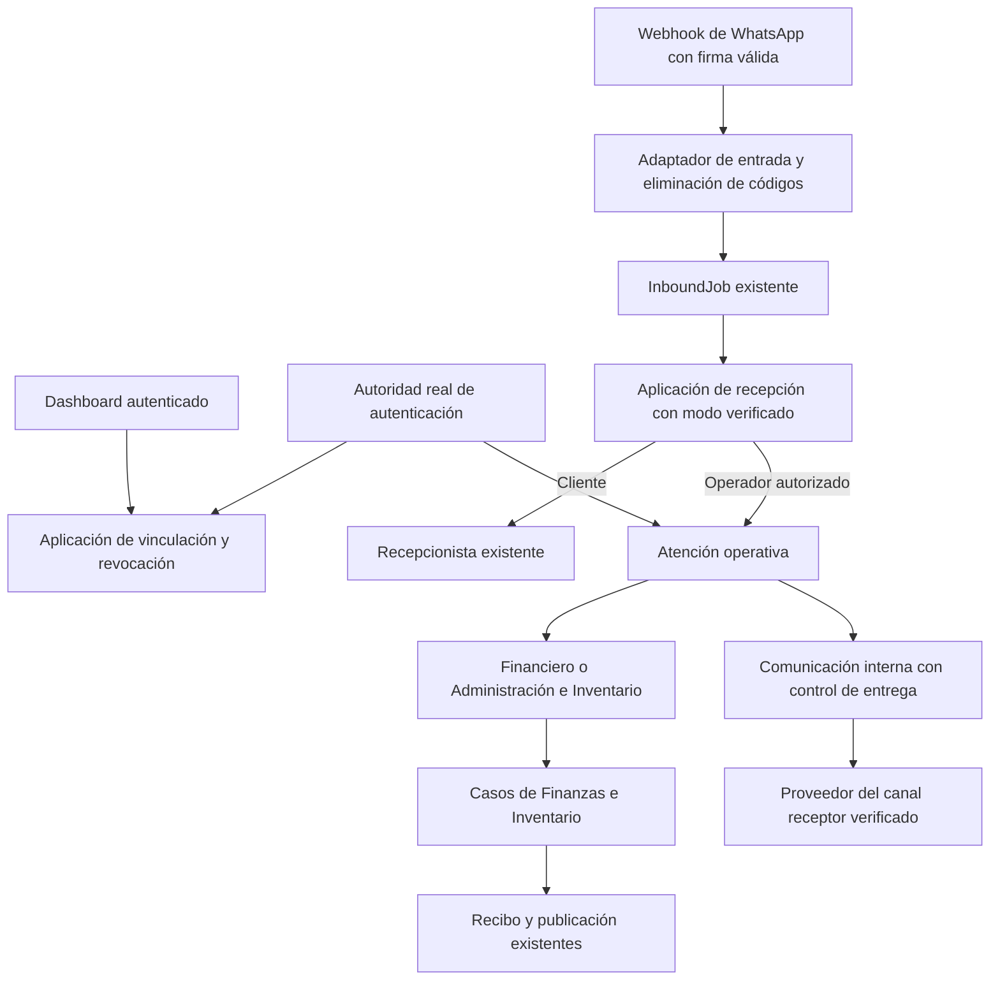

# Empleados operativos por WhatsApp — Etapa 3: arquitectura técnica

Fecha: **2026-10-15**, Colombia. **Estado: Etapa 3 y ADR 022 aprobados explícitamente por el responsable.**

Aprobación recibida: «Aprobar Etapa 3 y pasar a persistencia», en respuesta a la solicitud que incluía esta arquitectura y el ADR 022. Autoriza preparar la [Etapa 4](operational-employees-whatsapp-persistence-model.md); no autoriza implementar ni ejecutar migraciones.

Base: [definición funcional aprobada](operational-employees-whatsapp-functional-definition.md), [casos de uso aprobados](operational-employees-whatsapp-use-cases.md) y [modelo de dominio](domain-model-v1.md). No se implementan código, configuración, migraciones ni envíos con este documento. La decisión se registra además en el [ADR 022 aprobado](../decisions/022-empleados-operativos-canal-whatsapp.md).

## 1. Decisión y límites

Agregar un adaptador de WhatsApp para operadores, una aplicación de acceso verificado y atención interna en Comunicación. La aplicación invoca los mismos empleados operativos y contratos de Finanzas/Inventario; no utiliza un segundo bot con otra contabilidad ni un agente con herramientas de confirmación autónoma.

La solución mantiene PostgreSQL, la cola `InboundJob`, el worker actual y la publicación recuperable existentes. No incorpora otra cola, SDK de agentes, proveedor, número telefónico ni contexto de negocio. Las nuevas abstracciones de acceso son soporte de identidad; no constituyen una Organización que agrupe establecimientos.



El router de transporte traduce mensajes; la aplicación decide acceso, tarea y coordinación. Se conserva el principio del Plan Maestro: los canales no orquestan el dominio.

## 2. Evidencia del código y cambios necesarios

| Punto comprobado | Consecuencia del diseño |
| --- | --- |
| `webhook.routes.js` valida firma antes del controlador | Se conserva esa frontera. Ningún digest interno o botón público omite la verificación de origen. |
| `webhook.controller.js` guarda el payload de cada mensaje | Debe eliminar códigos de vinculación antes de encolar y conservar una representación verificable, sin perder hermanos del batch. |
| `whatsapp.service.js` reduce botones/listas a su título y admite fallback de receptor desde entorno | El adaptador interno lee los campos originales antes de esa reducción. Exige metadata real; no usa el título como confirmación ni el fallback como identidad interna. |
| Worker invoca al Recepcionista y exige `user.id` en respuestas | Se introduce un resultado tipado de cliente/operador/control; las respuestas internas no pasan por ese filtro de cliente. Se reutilizan leases y checkpoints. |
| `sendMessage` requiere cliente y usa canal activo por defecto | Se conserva el contrato de clientes; Comunicación incorpora un caso de uso de destinatario interno con ruta exacta y autorización propia. |
| Proveedor saliente usa `WHATSAPP_PHONE_NUMBER_ID` y `WHATSAPP_ACCESS_TOKEN` globales | El modo interno solo se habilita cuando el receptor real corresponde a esa misma línea y a un único Tenant activo. No se declara multiestablecimiento saliente resuelto. |
| `Channel` puede ser global y la búsqueda admite fallback | Para operadores se resuelve una ruta explícita comprobada; nunca se usa `findActiveDefault` como prueba del establecimiento. |
| Acceso Staff revalida credencial/versión; admin global se autentica con entorno en Next.js | Staff conserva su lector actual. El propietario necesita una autoridad viva de Next.js y una generación revocable coordinada en backend. |
| `store.access` bloquea Tenant/Staff/credencial; confirmación usa transacción y recibo | Se añade el control de vínculo/sesión en esa frontera transaccional, sin ejecutar primero y comprobar después. |
| `attention.request` fija origen `dashboard_operational` y `pending` rechaza revisión vencida | Se generaliza el origen de confianza y se añade renovación explícita de revisión, conservando operación y recibo; no se sortea la caducidad existente. |

Esta auditoría es de código y configuración declarada en Compose, no una certificación del VPS ni de un Tenant real. La comprobación de receptor/configuración contra la base real es un gate de activación posterior, de solo lectura antes de habilitar el canal.

## 3. Componentes y contratos de aplicación

Los nombres siguientes describen responsabilidades y contratos propuestos; no son tablas ni archivos creados.

| Componente | Contrato y dependencia |
| --- | --- |
| `OperatorChannelAccess` | Iniciar/probar/activar/reemplazar/revocar vínculo; abrir/cerrar/renovar sesión. Usa puertos de identidad, desafío, vínculo, modo, reloj y auditoría. |
| `OperatorAuthorityReader` | Devuelve principal real, generación de autoridad y estado vigente; Staff delega en credenciales actuales, administrador en su emisor real. No recibe rol elegido por WhatsApp. |
| `OperationalChannelResolver` | Resuelve `{tenantId, channelId, receivingAddress, providerRouteVersion}` a partir de metadata verificada y configuración saliente. Falla si falta correspondencia inequívoca. |
| `ReceiveChannelMessage` | Aplicación que serializa remitente/receptor, resuelve modo y llama al Recepcionista o a la atención interna. Mantiene un resultado discriminado; no llama directamente a Finanzas. |
| `OperatorAttention` | Conversación de tarea acotada: selección de empleado, aclaración, consulta, borrador, revisión, confirmación y recuperación. Usa `operationalAssistants`, sin replicar comandos. |
| `OperatorAccessGuard` | Revalida alcance y generación; se integra en `store.access` y en la entrega interna. La referencia de contexto se fabrica en servidor y nunca en el intérprete. |
| `SendOperatorMessage` | Caso de Comunicación con hilo/destinatario interno, ruta exacta, contenido tipado y evidencia de entrega. No llama al caso de cliente con un `User` ficticio. |
| Repositorios de atención interna | Mensajes/hilos y correlaciones por Tenant/principal; ninguna consulta de clientes los incluye. Modelo e invariantes persistidas: Etapa 4. |

Resultado de recepción: `customer` conserva el contrato anterior; `operator` contiene referencias a atención/respuesta interna; `control` contiene instrucciones genéricas sin datos privados. Un resultado no puede mezclar un destinatario de cliente con datos de operador. La pertenencia se resuelve en servidor al preparar y al enviar, no a partir de `phone` de un DTO anterior.

El composition root inyecta estos puertos. No se agregan dependencias de dominios de Finanzas/Inventario hacia Comunicación, Next.js o WhatsApp. La aplicación de acceso conoce la identidad, y Comunicación consulta un puerto de autorización de destinatario; sus casos de uso no importan credenciales de Staff ni variables del frontend.

## 4. Autoridad vigente del propietario y del personal

### 4.1 Staff

La verificación reciente reutiliza el servicio de login del personal. Las siguientes invocaciones usan el lector existente de Staff/credencial con versión, perfil, Tenant y módulos actuales. El teléfono no reemplaza la credencial. Desactivación o cambio de versión invalida el vínculo; reducción de permisos invalida las propuestas/respuestas afectadas aunque la sesión interna no haya vencido.

### 4.2 Administrador global: emisor real, generación y fencing

Se conserva la autenticación administrativa actual y su principal canónico; no se migra al propietario a una cuenta Staff ni se copia su contraseña al backend. Se extrae en Next.js un único verificador privado reutilizado por el login y la comprobación reciente de vinculación/renovación. El correo administrativo sigue reservado según el comportamiento actual de `auth.ts`.

Se añade un contrato privado entre backend y el emisor Next.js:

1. **Generación de credencial:** Next.js deriva un identificador mediante HMAC de versión de contrato, correo canónico y credencial configurada, con clave privada dedicada. No publica contraseña, hash verificable por diccionario ni esa clave. Cambiar correo, contraseña o clave cambia la generación.
2. **Registro del emisor activo:** antes de declarar lista su autoridad interna, cada arranque del emisor registra su instancia y generación en backend mediante un canal autenticado de servicio. Backend asigna una época monotónica. Reemplazar el emisor invalida su época anterior; un proceso anterior no puede volver a registrar su época ni sobrescribirla durante una consulta. La operación de registro está separada de la lectura de estado.
3. **Cambio de credencial:** registrar una generación nueva actualiza la autoridad revocable e invalida vínculos anteriores antes de permitir verificaciones con esa generación. Un reinicio con la misma generación cambia la época de emisor, pero no obliga a revincular teléfonos. Rotación de configuración se activa mediante esta barrera; no basta con editar un archivo mientras sigue funcionando el proceso anterior.
4. **Prueba reciente de usuario:** después de comprobar las credenciales actuales y la sesión propia del dashboard, el emisor produce una prueba de un solo uso, ligada al principal, Tenant, propósito, número/desafío y generación, con nonce y vencimiento de 60 segundos. No se reutiliza una prueba de iniciar para activar o renovar.
5. **Consulta viva:** cada operación privada pide al emisor una respuesta fresca para ese principal/generación y propósito. Devuelve coincidencia, época, nonce de solicitud y vencimiento de 30 segundos; no devuelve contraseñas. Respuestas ajenas, repetidas, fuera de vigencia o de época anterior se rechazan. No hay caché positiva entre operaciones.
6. **Frontera de ejecución:** bajo bloqueo en backend se comprueba que la generación/época de la respuesta sigue siendo la activa. La escritura o admisión del envío comparte esa protección con revocación/cambio de autoridad. Una prueba válida antes de la barrera no autoriza después de ella.

El RPC usa URL interna fija configurada por despliegue, nunca una URL aportada por usuario. En Compose el destino corresponde al servicio frontend; fuera de esa red se exige transporte privado protegido. Peticiones y respuestas se autentican con secreto dedicado, firma sobre método/ruta/body/timestamp/nonce y comparación segura; el rechazo no expone datos. El timeout máximo es dos segundos y los errores deniegan el uso interno. No se usa un token de navegador ni `INTERNAL_API_SECRET` como autorización pública genérica.

Nonce consumido y registro de época deben sobrevivir a un reinicio de backend. La autoridad no sirve solicitudes si no completó su registro actual. Su información es metadato técnico de autenticación, sin acceso global a negocios ni entidad de agrupación. Claves nuevas se provisionarán durante implementación/despliegue autorizado; no se crean con este diseño.

**Consecuencia:** WhatsApp interno del propietario depende de la disponibilidad de Next.js, además de backend y PostgreSQL. Se acepta para conservar una sola fuente de credenciales y revocación comprobable. Se rechaza el fallback «el vínculo decía admin» cuando ese emisor está caído. El dashboard no cambia de proveedor de login con esta ampliación.

### 4.3 Sincronización con efectos y revocaciones

La revocación no dependerá de que llegue un mensaje mientras la cuenta está desactivada. La auditoría de escritores encontró cambios en el repositorio de Staff, rutas de credenciales/equipo, configuración del negocio, configuración de Tenant y facturación. Una desactivación y posterior reactivación entre dos mensajes no puede devolver autoridad a un vínculo anterior.

Se propone invalidación atómica mediante generaciones de acceso derivadas de las fuentes de identidad en PostgreSQL. Triggers de infraestructura incrementarán la generación pertinente al cambiar estado/versión de credencial, identidad habilitada, permisos/rol o módulos/estado del Tenant. La generación de credencial invalida el vínculo; la de permisos invalida propuestas, interacciones y respuestas afectadas sin conceder un rol nuevo. Restaurar el valor anterior no restaura su generación anterior. No se reconstruyen esos cambios con un evento asíncrono posterior al commit. Etapas 4/5 definirán las relaciones y triggers exactos, incluidos deletes; las pruebas cubrirán también los escritores directos y transiciones desactivar/reactivar. No se modifica cómo Staff o Finanzas deciden sus reglas de negocio.

No se mantienen transacciones abiertas mientras se consulta al modelo o al emisor de autenticación. Se obtiene primero una prueba fresca; dentro de cada transacción se comprueba su generación, el estado local vigente y los permisos reales. Se conserva el orden actual de bloqueos Tenant → Staff/credencial y se añade autoridad/vínculo/sesión antes de solicitud/acción y recursos del dominio. Cambios de autoridad y revocaciones toman bloqueo exclusivo sobre la misma evidencia que protege cada efecto.

El guard se ejecuta también dentro del hook `before` de la entrada de Inventario, usando el mismo contexto transaccional del comando. Un control exterior de ruta no es suficiente. Finanzas ejecuta el guard dentro de su transacción de confirmación. Lecturas guardan el snapshot de acceso y revalidan antes de entregar el resultado; un snapshot anterior no conserva permiso.

Para una salida privada, Comunicación obtiene prueba viva, comprueba los registros bloqueados y admite la llamada al proveedor solo mientras conserva el control. La llamada interna tendrá timeout de cinco segundos y un límite de transacción mayor, acotado; errores de red dejan entrega incierta. Revocar espera una llamada ya admitida y bloquea las siguientes. La garantía se refiere a revocación confirmada antes de admitir el envío, no a retirar un mensaje que el proveedor ya aceptó. Se probarán los órdenes de bloqueo y carreras con PostgreSQL real antes de habilitar.

## 5. Entrada, secretos, modo y cola durable

### 5.1 Normalización antes de persistir

Después de validar firma, un adaptador nuevo extrae de cada mensaje remitente, receptor real, `wamid`, fecha, tipo, texto permitido, contexto del mensaje y acción interactiva. No modifica el parser protegido del motor de clientes. Mantiene el procesamiento de todos los mensajes del batch, incluso si uno es inválido.

Para `/vincular`, calcula en memoria el digest HMAC del código y elimina el código original antes de construir el payload durable. El código aleatorio tendrá al menos 128 bits de entropía; se muestra una sola vez en dashboard. La aplicación compara digests y verifica número/desafío/plazo; un digest no se acepta como código por una entrada pública. Errores, trazas HTTP y tareas excluyen cuerpos crudos de este flujo. Los nonces interactivos tampoco se guardan como tokens reutilizables en colas o logs generales.

El sobre durable distingue payload legado de mensaje normalizado interno/control. Solo el adaptador posterior a la firma puede construir el segundo. Un consumidor no acepta un campo público que diga `trusted: true`. Sin receptor real o `wamid`, las acciones internas se rechazan; los mensajes ordinarios de clientes conservan el tratamiento anterior.

### 5.2 Modo y convivencia

La aplicación resuelve el modo bajo serialización por combinación de receptor y remitente. Conserva una versión monotónica de modo: `/negocio`, `/clientes`, expiración y revocación invalidan las acciones pendientes del modo anterior. La cola procesa el cambio antes de admitir el mensaje siguiente de ese flujo; no se usan títulos del modelo para elegir identidad.

Un comando reservado, una acción interna o un flujo bloqueado nunca cae al Recepcionista. Los mensajes ordinarios de un número sin atención interna siguen el camino previo. Si faltan dependencias para determinar el modo de un flujo posiblemente interno, se reintenta el job o se bloquea, sin degradarlo a cliente. Audio/imágenes/documentos en modo negocio reciben indicación de utilizar texto/dashboard; no llegan a transcripción, visión ni memoria de clientes.

También las respuestas de cliente preparadas por el worker llevan una referencia a la versión de modo observada. Un cambio posterior la invalida antes del envío, evitando que un job antiguo siga conversando en el modo incorrecto. Los guards de toma humana y ventana actuales de clientes permanecen en su camino; el hilo interno no cambia su asignación.

### 5.3 Idempotencia y recuperación

Cada evento interno aceptado conserva una correspondencia durable de `wamid`/receptor con un UUID de solicitud y hash de entrada. Se asigna antes de llamar al empleado, sin generar otro UUID en un reintento. La correspondencia se comprueba de nuevo al recuperar un job cuyo lease perdió dueño. La solicitud existente y su fencing resuelven un crash entre terminar el trabajo y guardar el checkpoint del worker.

El modo se persiste antes de acusar el control; vínculo/consumo de desafío y activación se resuelven con operación indivisible. Ningún paso se considera recuperable solo por un mutex en memoria. El mutex existente puede serializar el adaptador, pero las versiones y transacciones son la garantía durable. No se anidan dos adquisiciones del mismo mutex del motor legado.

Se amplía el checkpoint del worker mediante una versión de contrato, conservando lectura de trabajos previos. El estado `sending` incierto no vuelve a ejecutar ni a enviar automáticamente; mantiene la política de la [recuperación segura existente](../decisions/011-recuperacion-segura-cola-entrante.md). Un resultado perdido se consulta por la solicitud/acción original.

## 6. Atención operativa y confirmación

El contexto interno se limita a la tarea seleccionada y sus campos admitidos. El intérprete no recibe el historial de clientes, códigos, tokens ni atributos de autoridad. Puede proponer intención o cambios de campos tipados; un validador determinista decide el paso. Confirmar, revocar y cambiar modo no son herramientas del modelo.

La aplicación reutiliza `request/getTask/getAction/revise/confirm/discard`. Añade origen de canal de confianza al iniciar tarea, con default compatible para dashboard. La búsqueda y selección de producto usan el catálogo autorizado; las selecciones se correlacionan con consulta y versión actuales. Cuando hay varios empleados de la misma especialización se exige elección explícita y no se toma el primer ID recibido.

Las aclaraciones completan el borrador elegido; no crean otra operación en cada respuesta. Corregir usa revisión esperada. Se añade renovación explícita de una propuesta vencida que aún no tenga recibo ni cierre: revalidar permisos/producto/contrato, crear otra revisión y conservar la acción y clave de ejecución. Nunca se confirma directamente una revisión vencida. Si no es renovable, se informa y se conserva su evidencia antes de iniciar otra solicitud mediante una decisión explícita del operador. Este cambio amplía el contrato de revisión, no las reglas de gasto/stock.

### Acción interactiva

Comunicación envía una propuesta completa con hasta tres botones: Confirmar, Corregir y Descartar. El identificador transportado es opaco, aleatorio o derivado mediante HMAC con separación de propósito; no contiene datos del gasto ni funciona como permiso por sí solo. Cada acción tiene referencia interna, digest, propósito, propietario, sesión, revisión/hash, vencimiento y correlación con el mensaje enviado.

El callback conserva tipo nativo, ID y contexto originales; el título «Confirmar» no se interpreta como consentimiento. Se comprueban remitente/receptor, vínculo, sesión, propósito, revisión y mensaje de propuesta. Contexto ausente/incompatible, reenvío señalado, texto libre o referencia antigua impiden ejecutar. Si el transporte no acredita la correlación exigida, se continúa en dashboard, conforme a W10.

La evidencia del envío de la propuesta debe quedar confirmada antes de habilitar la acción. Si se perdió la respuesta del proveedor y no se conoce el mensaje asociado, el botón no puede registrar nada; se muestra otra vez la misma revisión autorizada con una nueva interacción. El callback consumido y el recibo se coordinan con la transacción de negocio: un crash nunca deja un botón consumido como sustituto de evidencia ni abre una segunda ejecución. Repetir un callback válido recupera el recibo bajo permiso actual.

Para no persistir el nonce transportado en claro dentro de un checkpoint saliente, el worker guarda la referencia de interacción. El proveedor construye su ID verificable al enviar; se conserva su digest/correlación. Un ID pegado como texto no entra al manejador de callbacks.

Los ejemplos oficiales de Meta muestran [botones de respuesta y envío por línea](https://github.com/fbsamples/whatsapp-api-examples/blob/main/interactive-messages-js/list-and-button-basic/index.js) y [recepción del ID nativo de botón](https://github.com/fbsamples/whatsapp-api-examples/blob/main/template-for-ecommerce-js/routes/incomingWebhook.js). Se consultaron directamente y mediante Context7 el 2026-10-15; no se incorpora su SDK ni sus simplificaciones de autenticación. La exigencia de correlación/autorización aquí es nuestra medida de seguridad; el ejemplo no constituye evidencia de que Meta entregue siempre contexto. La prueba de contrato deberá verificarlo y ejercer el fallback seguro.

## 7. Comunicación, canal exacto y salida privada

Se incorpora una atención interna separada dentro del mismo contexto Comunicación, con repositorios propios y Tenant/principal obligatorios. No se vuelve opcional `Conversation.userId` para todos los consumidores ni se enlaza el operador a un cliente por teléfono. La historia/bandeja/RAG de clientes no consulta esos repositorios. Estados de atención y auditoría de identidad se definirán en Etapa 4.

`SendOperatorMessage` recibe referencia de hilo/atención, ruta comprobada, propósito y contenido de aplicación. Resuelve nuevamente al destinatario; valida proyección y snapshot de acceso actuales; comprueba sesión y ventana del canal usando mensajes internos verificables. No utiliza una entrada de cliente como prueba de autorización. Propuestas fuera de vigencia no conservan botones activos.

El registro de proveedores agrega capacidad para texto/acción interactiva con contexto de ruta, sin modificar el envío anterior de clientes y plantillas. Solo infraestructura de Comunicación llama a la API; los nuevos casos no llaman a `sendWhatsAppMessage` directamente. Se configura un timeout menor para la nueva salida interna, conservando el timeout legado para evitar cambios incidentales.

### Habilitación de la línea existente

- Receptor proviene de `metadata.phone_number_id` del evento firmado; debe resolver un único Tenant activo mediante la correspondencia existente de `Tenant.phone`.
- Debe coincidir exactamente con la línea saliente configurada. Sin token, canal activo o coincidencia, W1 y modo negocio quedan indisponibles con diagnóstico de configuración en dashboard, sin mostrar credenciales.
- Se reutiliza el `Channel` identificado de forma explícita. Un canal global existente solo puede utilizarse si el resolver acredita su correspondencia con esa única línea y Tenant; no es un fallback al no encontrar canal de otro negocio. Una ruta con Tenant/versión distintos se rechaza al enviar.
- Cambio de línea/configuración invalida la versión de ruta y las entregas/interacciones anteriores. La respuesta nunca sale por la línea global de otro Tenant.
- No se crea ni compra número, se registra un cliente ficticio ni se presume gestión de credenciales por Tenant. Ampliar a otra línea requiere primero el proveedor/configuración correspondiente y su propio diseño.

Los recibos determinan el resultado; las respuestas largas se paginan con cursor vinculado al alcance o continúan en dashboard autenticado. El formato es determinista para cifras, fechas, producto y efectos. Una explicación del modelo no modifica los valores oficiales ni reemplaza datos faltantes.

La entrega distingue preparada, admitida/enviando, aceptada, rechazada, bloqueada e incierta como resultados funcionales, sin imponer todavía enums. Persistir aceptación fallida después de que Meta acepte conserva incertidumbre y correlación. Reintentar una respuesta nunca llama otra vez al comando financiero o de stock.

## 8. Fronteras HTTP e interfaz

Se proponen rutas propias en Next.js para iniciar/activar/renovar/revocar vínculo y consultar su estado, con `auth()`, comprobación reciente y mismo origen/CSRF para mutaciones. Desde componentes cliente se usa proxy o estas rutas de servidor autenticadas, nunca `apiUrl` hacia backend protegido. No se aceptan `tenantId`, `principalKey` o `role` libres como autoridad; el propietario selecciona un Tenant autorizado desde su sesión.

Las rutas backend de gestión permanecen bajo autenticación interna y resolución de actor/Tenant existentes, con validación estricta de prueba de propósito. La excepción privada emisor-backend tiene autenticación de servicio dedicada, allowlist de operaciones/campos, timestamps/nonces y límites propios; no pertenece a la API pública de clientes. No se abre CORS ni se crea `ApiKey` para integradores.

El panel permite ver vínculo/estado, completar prueba, activar, renovar y revocar. Un administrador ve metadatos de vínculos que puede revocar, no el contenido de conversaciones ajenas. Contraseñas se envían solo al verificador de sesión autenticado correspondiente, nunca al chat o al modelo, y no se guardan en estado durable del formulario.

Errores de autorización son genéricos en WhatsApp; el dashboard muestra diagnósticos de configuración permitidos. No se inicia una campaña ni se envía un mensaje proactivo para probar la configuración. La primera prueba de transporte real será controlada y autorizada aparte.

## 9. Organización propuesta y pruebas requeridas

| Área | Cambio acotado previsto |
| --- | --- |
| `backend/src/contexts/communication/` | Casos/repositorios de atención interna, resolver de ruta, guard de destinatario y capacidad interactiva del proveedor. |
| `backend/src/contexts/agents/` | Atención operativa por canal y puerto de acceso de confianza; generalizar origen y renovar revisión sin duplicar comandos. |
| Capa de aplicación de acceso | Vínculos, desafíos, sesiones, autoridad/época y auditoría, con puertos de identidad actuales. Su repositorio no se accede desde el motor de clientes. |
| Controlador/worker de WhatsApp | Sanitización previa, sobre versionado, dispatch de aplicación, checkpoints y fencing de modo/entrega. |
| `frontend/` | Verificador administrativo compartido, emisor privado y UI de vínculo, con sesiones y rutas servidor existentes. |
| Composición/configuración | Inyección de puertos, registro del emisor y gate de canal, secretos dedicados y deshabilitación predeterminada hasta verificación. |

No se editan `whatsapp.service.js`, `conversation.service.js`, `scheduling.service.js`, `availability.service.js` ni `availability-db.service.js` para incorporar la ruta interna. El nuevo adaptador lee el webhook original y el wrapper llama al Recepcionista existente para clientes. Si la implementación demuestra que esto no basta, se detiene ese cambio y se reabre únicamente la decisión afectada bajo el [ADR 010](../decisions/010-reconciliacion-motor-conversacional-memoria.md); esta propuesta no autoriza una edición adicional de esos archivos.

Validación futura obligatoria:

1. Unitarias de verificación/normalización de códigos, scopes, tiempos, límites, interpretación sin confirmación y proyección de respuesta.
2. Integración real HTTP: webhook firmado, varios mensajes, receptor sin metadata, botones con/sin contexto, caracteres maliciosos, reenvíos, desafíos, CSRF y rutas privadas.
3. PostgreSQL real: doble activación/reemplazo, época de emisor anterior, revocación concurrente con confirmación/envío, permiso reducido, reinicio, nonce/lease fencing y mismo recibo entre canales. El éxito no se deduce de mocks de transacción.
4. Pruebas de caída del emisor, rotación de credenciales y registro de arranque: ningún admin local falso ni respuesta de época anterior autoriza. Un reinicio con credenciales iguales conserva el vínculo según contrato.
5. Pruebas de crash antes/después de cada checkpoint; mismo evento produce una solicitud; misma confirmación una sola operación; envío incierto no repite negocio. No se inspeccionan códigos en logs: se demuestra que no fueron persistidos.
6. Regresión completa de clientes, toma humana, reservas, recordatorios, proxy y ocho casos operativos. Grep del repositorio completo para envíos directos y uso de repositorios internos desde historial de clientes.
7. Lint, suites, build, Prisma y migraciones desde cero/upgrade tras aprobar Etapas 4/5. Habilitación y envío real solo tras los gates y autorización correspondientes.

No se presenta esta lista como evidencia ejecutada: esta etapa modifica documentos. Las pruebas anteriores acompañan a la implementación futura. Comprobación documental ejecutada el 2026-10-15:

```text
node scripts/check-docs.cjs
documents: 320; markdownFiles: 303; checkedLinks: 960
broken: []; missingDocReferences: []; catalogueErrors: []; exactDuplicates: []
exit: 0

node --test scripts/check-docs.test.cjs
tests: 6; pass: 6; fail: 0; exit: 0

git diff --check
exit: 0; sin errores de formato
```

## 10. Decisiones Arquitectónicas Diferidas

- **Modelo persistido y esquema:** entidades/agregados, propiedad, relaciones, estados, restricciones, TTL, retención y evolución de jobs/mensajes serán objeto de Etapas 4/5. Deben conservar todos los contratos ya fijados; no se difiere la solución de identidad ni la idempotencia a «ver al programar».
- **Múltiples emisores de autenticación o backends:** el diseño se acota a una instancia activa de Next.js y la topología actual. Fencing durable sigue siendo obligatorio ante reinicios. Replicación, disponibilidad sin emisor y caché positiva requieren diseño posterior; no se habilitan por escalar contenedores.
- **Varias líneas y credenciales por Tenant:** este alcance valida y reutiliza la línea existente. Gestión de secretos de múltiples líneas/proveedores no está resuelta ni prometida.
- **Otros medios y tareas:** voz, imágenes, facturas, grupos, campañas, recuperación proactiva de clientes y comandos operativos adicionales conservan su exclusión funcional.

Estas decisiones no son trabajo pendiente del alcance ni autorización para resolverlas de forma implícita. Si su resolución posterior altera una decisión aprobada, requiere su propio ADR según la regla del proyecto. Lo siguiente, tras aprobar esta arquitectura, es el **modelo de persistencia**; todavía no comienza la implementación.
