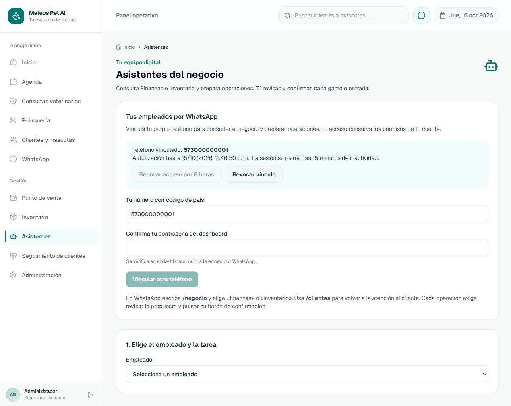

# Empleados operativos por WhatsApp — entrega local

Fecha: 15 de octubre de 2026, Colombia. Versión local: **2.48.0**. **Implementación y validación local completadas.** Este informe no certifica producción.

Correcciones posteriores autorizadas: [ajustes previos a publicación y evidencia final](EMPLEADOS_OPERATIVOS_AJUSTES_PREPUBLICACION_20261015.md). Los conteos de este informe conservan la primera validación; el nuevo informe documenta recuperación tras vencimiento, límites nativos, ruta privada y CI.

## Autorización y alcance

El responsable aprobó explícitamente las cinco etapas y «Aprobar Etapa 5 e implementar localmente». Se implementa el [ADR 022](../decisions/022-empleados-operativos-canal-whatsapp.md) y el [esquema físico aprobado](../architecture/operational-employees-whatsapp-physical-schema.md). No se autorizaron commit, push, tag, despliegue, migraciones productivas ni mensajes reales.

Los mismos empleados Financiero y Administración/Inventario conservan los ocho casos de uso del [cierre anterior](ENTREGABLE_EMPLEADOS_OPERATIVOS_COMPLETION_REPORT.md). WhatsApp añade un adaptador privado; no añade operaciones financieras, reglas de stock, otra unidad de aislamiento ni un contexto de negocio.

## Resultado implementado

- Panel «Tus empleados por WhatsApp» en Asistentes: verificación reciente de contraseña, código mostrado una vez, prueba desde el teléfono esperado, activación en dashboard, renovación, revocación y revisión de mensajes interrumpidos.
- Identidad real del administrador global mediante emisor privado firmado. Boot/época y generación de credencial son independientes: reiniciar conserva vínculos con credencial igual; A→B→A no reactiva vínculos antiguos. Staff conserva su ID, credencial, sesión, rol, áreas y capacidades actuales.
- `/negocio` abre una sesión privada de 15 minutos de inactividad dentro de una autorización de ocho horas. `/clientes` vuelve explícitamente al canal del cliente. Expiración, revocación y fallos mantienen el modo bloqueado.
- Selección de Financiero/Inventario, consultas, preparación de propuestas, corrección y selección nativa de productos, paginación, recuperación y confirmación nativa. Un «sí» escrito no ejecuta operaciones. Sin correlación nativa fiable se indica continuar en dashboard.
- Un mismo recibo y clave de ejecución entre canales. Revisión exacta, permisos, metadatos del producto, sesión y línea se validan nuevamente antes del efecto. Una propuesta adoptada con otra generación de permisos exige nueva revisión.
- Dieciséis tablas de soporte y dos migraciones aditivas. Historial de cliente y privado separados; no se inventan `User` ni `Staff` para operadores. Se mantiene el caso de uso público de Comunicación con su `userId` obligatorio.
- Cola entrante existente con sobres sanitizados, ordinal por participante, lease/poseedor/generación y barreras de modo. Códigos y botones se convierten a digests antes de persistir. Un predecesor incierto espera revisión explícita, sin detener otros teléfonos.
- Transporte privado dentro de infraestructura de Comunicación. Reserva `sending` y auditoría antes de llamar; prueba viva y bloqueo de fuentes antes de enviar; timeout de cinco segundos; incertidumbre durable, sin repetición automática. Mantenimiento conserva tombstones, borra digests consumidos y cierra sesiones/interacciones vencidas.

## Validación reproducible

Pruebas en PostgreSQL 18/pgvector, contenedor propio sin volúmenes, puerto `127.0.0.1:55432`. Las suites requieren variables explícitas de base desechable; nunca toman `DATABASE_URL` de producción. Los nombres comienzan por `operational_test`. La suite de cola crea su propio esquema UUID y recorre las 52 migraciones conservando la muestra histórica de 8.2.

```powershell
# Desde la raíz; sustituir únicamente por una base local desechable ya migrada.
$env:OPERATIONAL_TEST_DATABASE_URL='postgresql://operator_test@127.0.0.1:55432/operational_test_whatsapp_verified'
node --test --test-concurrency=1 backend/tests/postgres/operational-assistants.test.cjs backend/tests/postgres/operator-whatsapp.test.cjs
$env:INBOUND_TEST_DATABASE_URL=$env:OPERATIONAL_TEST_DATABASE_URL
node --test backend/tests/postgres/inbound-queue.test.cjs
node --test scripts/operator-channel-reauth.test.cjs scripts/operational-assistants-proxy.test.cjs
```

Las suites de atención comparten barridos globales del worker: se ejecutan secuencialmente en una misma base, o en bases independientes. Sus carreras internas siguen siendo concurrentes. Se corrigió también la detección de `DriverAdapterError.cause.originalCode` al hacer commit: los conflictos 40001/40P01 reintentan tras rollback, con espera corta y límite de tres intentos. Ningún timeout de proveedor se interpreta como rollback seguro.

Resultado final de los comandos, ejecutados con Node 24 y bases desechables explícitas:

```text
Jest --runInBand: success=true; 193 suites passed; 1545 tests passed; 0 failed.
node --test --test-concurrency=1 [operational-assistants, operator-whatsapp]:
  tests 56; pass 56; fail 0.
node --test backend/tests/postgres/inbound-queue.test.cjs:
  tests 13; pass 13; fail 0.
node --test [operator-channel-reauth, operational-assistants-proxy, check-docs]:
  tests 22; pass 22; fail 0.
npm run lint (frontend): exit 0.
Next production build: compilación y TypeScript aprobados; 32 páginas generadas.
prisma validate: The schema at prisma/schema.prisma is valid.
prisma migrate deploy (base nueva): 52 migrations found; All migrations have been successfully applied.
git diff --check: exit 0.
check-docs: 1005 enlaces; cero rotos, referencias faltantes o errores de catálogo.
```

El cliente Prisma fue regenerado tras integrar el esquema. La integración HTTP recorrió firma de webhook → cola → empleado → botón nativo → gasto/recibo, usando transporte e intérprete simulados, sin servicios externos. Las 23 pruebas de WhatsApp incluyen identidad administrativa real, Staff, aislamiento, vinculación, revocación, permisos restaurados, carreras entre canales, revisión vencida, confirmaciones reenviadas, paginación de productos, cambio de línea, mantenimiento e incertidumbre. Las otras 33 pruebas operativas certifican los comandos canónicos y su recuperación.

La primera repetición de PostgreSQL después de la pausa falló por Docker cerrado, antes de conectar. Se inició Docker, se recreó exclusivamente el contenedor desechable y se aplicó la cadena completa sobre una base vacía; los resultados 56/56 y 13/13 anteriores corresponden a esa ejecución nueva. El comando Jest final aprobó 193/193 suites.

### Revisión arquitectónica y comprobaciones exhaustivas

Se conservaron Tenant como unidad de aislamiento, los ocho casos aprobados y el precio resuelto por el contrato existente. No cambian reglas de comisión, Finanzas o stock. La coordinación técnica vive en aplicación; el transporte específico vive en infraestructura de Comunicación. No se introduce otro motor, contexto de negocio, consumidor de API pública ni agrupación superior a Tenant. El Plan Maestro conserva su roadmap; el modelo conceptual y los índices de documentación reflejan esta implementación local.

El grep sobre el repositorio completo encontró una única invocación de `sendWhatsAppMessage(...)`, en el proveedor existente de Comunicación. La nueva llamada Graph está en `operator-whatsapp-provider.js`, dentro de esa misma infraestructura. Los consumidores preexistentes de audio/Graph se conservaron. No hay `apiUrl` en los nuevos componentes autenticados ni altas de `User`/`Staff` en el adaptador privado. Se verificaron los digests de admisión y los errores sanitizados de trabajos privados. El diff de los cinco servicios protegidos de WhatsApp/conversación/agenda/disponibilidad está vacío. Esquema activo: exactamente 16 modelos `Operator*`; backend, raíz del lockfile y `packages[""]` coinciden en 2.48.0; salud importa esa versión.

### Recorrido visual con datos ficticios

En el dashboard local se comprobó inicio de sesión, selección de establecimiento, código de vinculación, prueba simulada desde el teléfono esperado, activación, renovación de ocho horas, registro de ambos empleados y revocación. La contraseña se limpia tras verificar. No se usaron cuentas, teléfonos o credenciales reales. La captura muestra el estado intermedio activado; después se verificó su revocación. Al cerrar el simulador quedaron cero gastos, cero recibos y cero entradas de inventario de ese recorrido; los dos empleados registrados pertenecían únicamente al Tenant de prueba.



Los servidores del simulador se cerraron y se retiró el contenedor de pruebas sin volúmenes, descartando sus datos ficticios. No se modificó el contenedor habitual de desarrollo.

## Configuración y habilitación posterior

Las plantillas [backend](../../backend/.env.example) y [frontend](../../frontend/.env.example) mantienen `OPERATOR_WHATSAPP_ENABLED=false` y la clave de servicio vacía. La plantilla pública del frontend queda exceptuada del ignore; los entornos reales permanecen ignorados. No se alteraron las claves reales ni se activó la línea del negocio.

Para habilitar en un entorno autorizado se necesitan las migraciones, una misma `OPERATOR_CHANNEL_HMAC_KEY` aleatoria de al menos 32 bytes en ambos servidores, la misma `OPERATOR_CHANNEL_KEY_VERSION`, el secreto interno existente y una `OPERATOR_AUTHORITY_URL` fija desde backend al endpoint privado de Next. Ese endpoint verifica HMAC, propósito, método/ruta, reloj y nonce; nunca recibe la contraseña administrativa del backend. El emisor se registra antes de conceder acceso privado. Una instancia antigua queda cercada por su época.

La línea saliente configurada debe coincidir con el receptor firmado de Meta, `Tenant.phone` y el canal activo. La unicidad existente de `Tenant.phone` ya impide asignar el receptor a dos establecimientos. No se añade otra regla de negocio para ese caso.

El simulador local permite comprobar la interfaz sin proveedores externos:

```powershell
$env:OPERATOR_UI_CHANNEL='1'
node scripts/serve-operational-assistants-local.cjs
# En su stdin, solo para la prueba: link CODIGO_VISIBLE_EN_LA_UI
# stop cierra los servidores. No usar números o credenciales reales.
```

## Límites de esta certificación

No se ha certificado el envío por Meta, un teléfono real, el acceso por la red privada del VPS ni la configuración productiva de los nuevos secretos. La interfaz y los contratos nativos se comprueban con datos desechables y transporte simulado. Estos límites no autorizan sustituir el proveedor real por el simulador en producción.

Los informes de 2.47.0 conservan su evidencia histórica. El backend y su lockfile declaran 2.48.0; salud obtiene la versión desde ese mismo package. No se creó tag ni publicación. El cierre local habilita revisar los cambios y preparar, con autorización posterior, su publicación y una prueba real controlada del canal.
